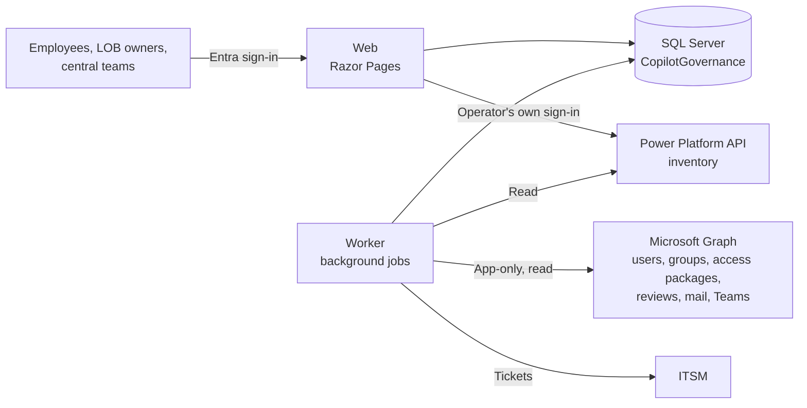

# Copilot Consumption Governance Workbench

The institution's record of who owns and funds each Copilot workload, who approved each change under which
decision right, and what evidence shows the approved setting is in place. Microsoft's admin centers keep
enforcing limits and measuring consumption; the Workbench reads from them and never writes to them.

## What it does

- A start page per person: eight journeys (routine access, new workload, exception, capacity change,
  consumption event, recertification, retirement, commercial decision), each showing who acts next.
- A register of funding owners (LOBs and Enterprise Shared), cost centers, services, control templates,
  workloads, envelopes, delegations and commercial inventory, versioned by date.
- Decisions routed by the RACI matrix: one accountable role per activity, separate records for budget,
  risk and purchase, every approval with an expiry or review date.
- Fulfillment through ITSM tickets, then verification by a second operator (read-back or attestation).
- Email and Teams notices with reminders at 50 and 80 percent of each SLA and an escalation ladder.
- Drift and unregistered-agent findings, exceptions with expiry, recertification, retirement, KPIs.

## What it does not do

- It never changes a Microsoft setting, buys capacity or stops consumption. Operators do that in the admin
  centers through approved ITSM tasks.
- It does not replace Entra approvals for routine access, ITSM for fulfillment, or Purview for compliance.
- A budget alert is never treated as a stop, and an allocation is never treated as a cap while tenant-pool
  draw or a PAYG plan is on. These are tested.

## How it fits together



One web application and one worker share one database. All calls go out from the data center; nothing
comes in. The database keeps decisions, evidence and the audit trail in tamper-evident ledger tables, and
shows each LOB only its own rows.

## Repository

| Folder | What is there |
|---|---|
| `src/Governance.Database` | Schema scripts (run in order, safe to rerun) and `Deploy-Database.ps1` |
| `src/Governance.Domain`, `src/Governance.Application` | Codes, rules, segregation of duties, the workflow engine |
| `src/Governance.Infrastructure`, `src/Governance.Notifications` | Microsoft, ITSM, mail and Teams adapters; message templates |
| `src/Governance.Web`, `src/Governance.Worker` | The site and the background jobs |
| `tools/Governance.Seed` | The demo institution and sample requests for the test environment |
| `tools/Governance.MockItsm` | A local ITSM stand-in for testing |
| `setup` | Test tenant setup (app registrations, groups, access packages, mailbox, Teams app) |
| `tests` | Unit, integration (real SQL Server), contract and UI tests |
| `docs` | Test environment, operations, runbooks, user guide, decisions |

## Quick start (local test environment)

Full steps are in [docs/TEST-ENVIRONMENT.md](docs/TEST-ENVIRONMENT.md). In short:

```powershell
pwsh -File setup\Setup-TestTenant.ps1 -TenantDomain <your domain> -AdminUpn <your admin UPN>
pwsh -File src\Governance.Database\Deploy-Database.ps1 -SqlServer localhost -Database CopilotGovernanceTest -CreateSqlLogins -LocalSettingsPath config\appsettings.Local.json
dotnet run --project tools\Governance.Seed -- --database CopilotGovernanceTest --sample-requests
```

Then start the mock ITSM, the worker and the web (port 5450) and sign in.

## Documents

- [Test environment](docs/TEST-ENVIRONMENT.md): set up, run and try one request end to end.
- [User guide](docs/USER-GUIDE.md): where each role starts and what it does.
- [Operations](docs/OPERATIONS.md): every admin page and background job.
- [Runbooks](docs/RUNBOOK.md): what to do when something fails.
- [Decisions](docs/DECISIONS.md): the open decisions taken and where the build differs from the architecture.
