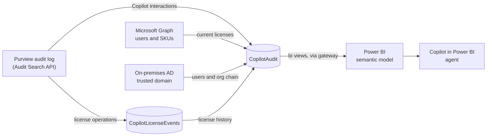

# Deploying the Copilot audit pipeline

From an empty SQL Server to a Power BI model refreshed every night, with a Copilot agent that answers questions about it. Microsoft 365 Copilot audit records come from Purview, licenses from Microsoft Graph, and the organization from on-premises Active Directory.

Written for a new install of release 2.5.4. Hands-on time is about a day, plus approvals. [RUNBOOK.md](../RUNBOOK.md) has the reference detail: limits, tuning and the full troubleshooting table. [SCRIPTS.md](SCRIPTS.md) summarizes every script. [BUILD-FROM-SOURCE.md](BUILD-FROM-SOURCE.md) is for compiling the dashboard yourself, which an install does not need. [SCHEMA.md](SCHEMA.md) lists every table and view the scripts create, column by column.

- [What you're deploying](#what-youre-deploying)
- [Decide these first](#decide-these-first)
- [The short version](#the-short-version)
- [Phase 1: Prepare](#phase-1-prepare) (steps 1-4)
- [Phase 2: Load the history](#phase-2-load-the-history) (steps 5-7)
- [Phase 3: Build the reporting layers](#phase-3-build-the-reporting-layers) (steps 8-11)
- [Phase 4: Run it every night](#phase-4-run-it-every-night) (steps 12-13)
- [Phase 5: Connect Power BI](#phase-5-connect-power-bi) (steps 14-16)
- [Phase 6: Add the Copilot agent in Power BI](#phase-6-add-the-copilot-agent-in-power-bi) (steps 17-20)
- [Check it's healthy](#check-its-healthy) (step 21)
- [Phase 7: The Copilot Insights dashboard (optional)](#phase-7-the-copilot-insights-dashboard-optional) (steps 22-25)
- [Running it](#running-it)
- [What has run in the lab](#what-has-run-in-the-lab)
- [Not yet proven in a live deployment](#not-yet-proven-in-a-live-deployment)

## What you're deploying

Seven parts, all read-only towards Microsoft 365: nothing here changes anything in Microsoft 365, Entra or Azure (the dashboard's writes are listed in [DASHBOARD.md](DASHBOARD.md)). Everything lands in two SQL Server databases. A Power BI model imports the reporting views from one of them, and Copilot in Power BI answers questions from that model.



Only the Purview and Graph arrows need the app registration.

| Component | What it does | Runs on | Writes |
|---|---|---|---|
| `Invoke-CopilotAuditBackfill.ps1` | Downloads audit records through the Purview Audit Search Graph API and bulk-loads them. With `-Incremental` it keeps them current and refreshes everything derived from them. | Job server, PowerShell 7.2+ | `audit.CopilotAudit`, `audit.CopilotInteraction` |
| The same script, second database | Collects the license operations (*Change user license*, *Update user*, *Add user*, *Delete user*), the only record of license history, and Copilot Studio's authoring operations (*BotCreate*, *BotUpdateOperation-BotPublish* and the rest) in the same searches. | Job server | `audit.LicenseEvent`, `audit.vLicenseSkuChange`, `audit.AgentEvent` |
| `tools/Export-UsersWithHierarchy-ToSql.ps1` | Reads every user in a trusted AD domain: title, department, division, office, manager, management chain, whether the account is enabled. | A machine that reaches the trusted domain; PowerShell 5.1 or 7 | `audit.UserDirectory`; `audit.GroupMember` (members of AD groups granted Organization, for Power BI) |
| `tools/Update-CopilotAuditEnrichment.ps1` | Who holds a Copilot license now, and since when. | Job server | `audit.CopilotLicense` |
| SQL procedures | Flatten the records, infer sessions and the Saturday–Friday weekly rollup, and fill the `bi` star schema. | SQL Server 2017+ | `audit.RawLogFlattened`, `audit.CopilotSession`, `audit.CopilotWeeklyRollup`, `bi.*` |
| Power BI | Imports the `bi` views through the on-premises data gateway, refreshing only recent hours of the interaction fact. | Power BI service | — |
| Copilot in Power BI | Answers plain-language questions from the model: in the report's Copilot pane, and in the standalone Copilot (preview). The model carries the instructions and verified answers that ground it. | A paid Fabric (F2+) or Premium (P1+) capacity | — |

## Decide these first

Each is awkward to change after the first load. The examples below use the names in `code`; replace them with yours.

- **SQL Server and the two databases.** `SQLPROD01`, `CopilotAudit` and `CopilotLicenseEvents`. They must be separate databases: the loader refuses to mix operation sets in one.
- **The job server.** One Windows server that runs every scheduled step. It must reach `login.microsoftonline.com` and `graph.microsoft.com` over HTTPS, the SQL Server, and a domain controller of the domain your users are in. The AD export reads a *trusted* domain and refuses the domain the server itself is joined to, so the users must live in a different domain from the job server.
- **The service account.** A group managed service account (gMSA), so there is no password to store or rotate. This guide uses `CORP\gmsa-copilot$`. The AD trust must let it read user objects (by default any authenticated user can).
- **The reporting time zone.** Days and Saturday–Friday weeks are cut in the installing server's own time zone (2.4.10; before, Eastern time whatever the server) unless you pass `-ReportingTimeZone` to the setup in step 3, such as `'GMT Standard Time'` (a name from `sys.time_zone_info`). It is stored in both databases and every procedure reads it. It can't be changed once records are loaded.
- **How much history.** Microsoft keeps Copilot audit records for 180 days. More exists only if a custom retention policy covered Copilot at the time (step 1).
- **Capacity for the Copilot agent.** Copilot in Power BI needs a paid Fabric (F2+) or Premium (P1+) capacity. Outside the US or EU data boundary it also needs a tenant setting that lets data be processed in another region (step 17). Buying capacity and that residency decision both take time, so start them now.
- **Which employee types to load.** The AD export loads `employeeType` codes `EMP` and `NONW` by default, written as EMPLOYEE and CONTRACTOR. Check the codes your directory uses; `-EmployeeTypes @()` loads every type.
- **Where the department is.** The AD export reads AD's `department` (2.5.0). If your directory keeps it in another attribute, name it with `-DepartmentAttribute`, first choice first: `-DepartmentAttribute pncUCustom08, department` uses the custom attribute and falls back to AD's own. Set `DepartmentAttribute` the same in `copilot-audit.settings.psd1`, or pass `-DepartmentAttribute` to `Install-CopilotJobServer.ps1`, so the nightly run agrees. Country is `co`, else the English name of the two-letter code in `c`, since many directories set only `c`.

## The short version

Three commands on the job server, after the approvals in step 2 and the service account in step 3:

```powershell
# 1. Everything on the job server and SQL Server, and the app registration (elevated; you sign in once as an admin who can consent)
.\tools\Install-CopilotJobServer.ps1 -SqlServer SQLPROD01 -ServiceAccount 'CORP\gmsa-copilot$' `
    -TargetDomain users.contoso.com -TenantId contoso.onmicrosoft.com -RegisterApp

# 2. The history, built (hours; run it again to resume if it stops)
.\Invoke-CopilotPipeline.ps1 -History

# 3. From tonight, the scheduled task runs .\Invoke-CopilotPipeline.ps1 on its own.
```

The steps below explain each command, and give the alternatives where your organization splits the work (a DBA who runs SQL, an identity team who registers apps). Nothing in them is typed into SQL by hand.

### Which PowerShell runs what

Windows PowerShell 5.1 (`powershell.exe`) and PowerShell 7 (`pwsh.exe`) install side by side. Most scripts need 7; the dashboard's installer needs 5.1.

| Script | Runs in |
|---|---|
| `Invoke-CopilotAuditBackfill.ps1`, `Invoke-CopilotPipeline.ps1`, `tools\Install-CopilotJobServer.ps1`, `tools\New-CopilotAuditApp.ps1`, `tools\Import-CopilotAuditCsv.ps1`, `tools\Add-CopilotTenant.ps1`, `tools\Save-CopilotAuditModules.ps1` | PowerShell 7.2+ only. The loader compiles its C# engine in memory, against the .NET that PowerShell 7 brings. |
| `Install-CopilotAudit.ps1`, `tools\Invoke-CopilotMaintenance.ps1`, `tools\Export-UsersWithHierarchy-ToSql.ps1` | Either. Prefer 7: Windows PowerShell 5.1's SQL client may not offer TLS 1.2, which a SQL Server that requires it rejects with *An existing connection was forcibly closed*. |
| `dashboard\Install-CopilotInsights.ps1` | Windows PowerShell 5.1 only. The IIS provider it uses doesn't exist in 7. |

Run everything else, such as the license tool, in PowerShell 7, as the nightly task does. It calls `pwsh.exe` directly, so PowerShell 7 must be installed on the job server.

### Connecting to SQL Server

Every script connects to SQL Server encrypted. If the instance presents its own self-signed certificate, which is the default, the connection fails with *A connection was successfully established with the server, but then an error occurred during the login process*. The part in brackets after it names the cause:

| In brackets | Cause | Fix |
|---|---|---|
| *The certificate chain was issued by an authority that is not trusted* | The client doesn't trust SQL Server's certificate. | Add `-TrustServerCertificate` to every command, the dashboard's installer included. Step 3 saves it for the nightly run. The connection stays encrypted; only the certificate's issuer isn't checked. Or give SQL Server a certificate from your own CA. |
| *The target principal name is incorrect* | Connected by IP address, alias or `localhost`, and the name doesn't match the certificate. | Use the server's name as its certificate carries it, or `-TrustServerCertificate`. |
| *An existing connection was forcibly closed by the remote host* | TLS versions don't match, usually Windows PowerShell 5.1 against a SQL Server that requires TLS 1.2. | Run the script in PowerShell 7. |

## Phase 1: Prepare

Retention, the app registration, the job server and SQL Server. The admin consent and the gMSA usually take the longest to get, so ask for them first.

### Step 1. Check how much history exists

*Exchange Online PowerShell, compliance admin. About 10 minutes.*

```powershell
Get-UnifiedAuditLogRetentionPolicy |
    Format-List Name, RecordTypes, Operations, RetentionDuration, Priority
```

If no policy mentions Copilot, plan for 180 days. Asking for more returns empty windows, not an error.

### Step 2. Register the app

*Global Administrator or Privileged Role Administrator, to consent. About 5 minutes, done by step 3's `-RegisterApp`.*

`tools\New-CopilotAuditApp.ps1` registers the app. Step 3 runs it for you with `-RegisterApp`, and it can also run on its own on any machine with PowerShell 7. It signs you in to Microsoft Graph once, then:

1. Creates the app **Copilot audit pipeline**: single tenant, no redirect URI, no client secret. The scripts sign in with a certificate only.
2. Asks for the three application permissions below, and nothing else.
3. Grants admin consent to each.
4. Uploads the job server's certificate.

It prints the tenant and client ids and writes them into the job server's settings. Run it again at any time: it changes only what is missing, and adds a renewed certificate alongside the old one. Step 3 passes the client id in the settings as `-ClientId`, so a later run finds the app by it. By name alone, it takes an app already there only when it is the only one of that name, has no client secret and no owner but you; otherwise it stops and changes nothing, and `-ClientId` names the app to use (2.4.12; before, any app of that name, someone else's included, was given the permissions and consent).

```powershell
.\tools\New-CopilotAuditApp.ps1 -TenantId contoso.onmicrosoft.com -CertificatePath D:\CopilotAudit\copilot-audit.cer
```

Add `-UseDeviceCode` on a server with no browser. If your identity team registers apps by hand instead, give them this table and the `.cer` file from step 3. Then pass the resulting client id to step 3 as `-TenantId` and `-ClientId`.

| Permission | Used by | For |
|---|---|---|
| `AuditLogsQuery.Read.All` | The loader: backfill and `-Incremental`, both databases | Copilot interaction records and license operations. Microsoft offers no Copilot-only audit permission, so the all-services one is needed. |
| `User.Read.All` | License tool | Each user's assigned licenses and plans, and the list of license holders who never used Copilot. |
| `LicenseAssignment.Read.All` | License tool | The tenant's SKUs, to find the Copilot ones. |
| `User-LifeCycleInfo.Read.All` (optional, 2.4.3) | License tool with `-IncludeLeaveDates` | Each user's `employeeLeaveDateTime`, for Licensing › Departures ahead. Leave it out and the page uses AD's account expiry alone. |

The app needs no Purview role: the Audit Reader role applies to a person signing in, not to an app. User attributes come from AD, which needs no Graph permission.

### Step 3. Prepare the job server

*Job server, in an elevated PowerShell 7 window, as a sysadmin on SQL Server. About 20 minutes.*

**Before you start.** Ask AD for the group managed service account (gMSA), `CORP\gmsa-copilot$` here, with the job server allowed to retrieve its password. Install PowerShell 7.4 (7.2 is the minimum). Then take the release's source zip, `copilot-audit-backfill-vX.Y.Z.zip`, and its `.sha256`, from the release page. Since 2.6.5 no release bundles the external modules (the offline zip is gone): save them into a `Modules` folder next to the scripts, from the PowerShell Gallery or your own feed that mirrors it. That matters here: a module installed for your own account would be invisible to the gMSA. The scripts need `Microsoft.Graph.Authentication`, `ImportExcel` for the agent workbook, and `PnP.PowerShell` for a workbook on SharePoint Online; `.\tools\Save-CopilotAuditModules.ps1` saves the first two at the versions the release was tested with, signatures and hashes checked.

```powershell
$zip = 'copilot-audit-backfill-v2.6.5.zip'
(Get-FileHash ".\$zip" -Algorithm SHA256).Hash   # must equal the first value in "$zip.sha256"
Unblock-File ".\$zip"
Expand-Archive ".\$zip" -DestinationPath 'D:\'
Rename-Item 'D:\copilot-audit-backfill-v2.6.5' 'CopilotAudit'
cd D:\CopilotAudit
.\tools\Save-CopilotAuditModules.ps1                                  # where the server can reach the gallery
Save-Module PnP.PowerShell -Path .\Modules -Repository PSGallery      # only for a workbook on SharePoint Online
```

**Then one command:**

```powershell
.\tools\Install-CopilotJobServer.ps1 -SqlServer SQLPROD01 -ServiceAccount 'CORP\gmsa-copilot$' `
    -TargetDomain users.contoso.com -TenantId contoso.onmicrosoft.com -RegisterApp
```

`-TargetDomain` is the users' domain, which the directory load reads over the trust (step 9). Add `-ReportingTimeZone 'GMT Standard Time'` for another zone, `-Dashboard` if you will install the dashboard (Phase 7), and `-TrustServerCertificate` for a SQL Server with a self-signed certificate. The script:

1. **Certificate.** Creates a self-signed certificate in LocalMachine\My: 2048-bit RSA, private key not exportable, valid 2 years. It exports the public half as `copilot-audit.cer`. To use your own PKI instead, import the certificate first and pass `-CertificateThumbprint`.
2. **Service account.** Checks the gMSA is installed on the server, installing it when the ActiveDirectory module is present. Gives it *Read* on the certificate's private key, and *Log on as a batch job*. If a domain Group Policy sets that right, add the account there too, or the policy removes it at its next refresh.
3. **Connectivity.** Checks `login.microsoftonline.com` and `graph.microsoft.com` on 443, and warns if they aren't reachable directly (a system proxy is fine).
4. **Databases.** Runs step 4's `Install-CopilotAudit.ps1` with the service account.
5. **App registration.** With `-RegisterApp`, runs step 2's script with the new certificate.
6. **Settings.** Writes `copilot-audit.settings.psd1` next to the scripts: the server, databases, tenant, client id, thumbprint, users' domain and log folder. Every later command reads them. The delete guard's percentages (2.6.5) are not written: each load that replaces a whole table refuses one 15% smaller than the last unless you add its own setting, such as `UserDirectoryMaxDropPercent = 10`. [OPERATIONS.md](OPERATIONS.md#the-pipeline) lists the five.
7. **The nightly task.** Registers *Copilot audit - nightly*, daily at 02:00 (`-At` to change it), as the gMSA, running `Invoke-CopilotPipeline.ps1` (steps 12-13).

It ends by listing what is left. Run it again at any time with no parameters, and it redoes only what is missing. A new certificate is made only with `-RegisterApp`, which uploads it to the app of every tenant in the settings: without it, a certificate within 30 days of expiry is kept, and the list says to renew it (2.4.12; before, any run in those 30 days switched to a new certificate no app had, and the nightly sign-in failed). `-SkipDatabase` and `-RegisterApp` aren't saved in the settings, so pass them again on each run that needs them.

**A service account with a password instead of a gMSA.** Name it without the trailing `$`, and give its password with `-ServiceAccountCredential` so the nightly task can store it:

```powershell
$cred = Get-Credential -UserName 'CORP\svc-copilot' -Message 'Copilot audit service account'
.\tools\Install-CopilotJobServer.ps1 -SqlServer SQLPROD01 -ServiceAccount 'CORP\svc-copilot' -ServiceAccountCredential $cred `
    -TargetDomain users.contoso.com -TenantId contoso.onmicrosoft.com -RegisterApp
```

The gMSA check is skipped for a name without `$`. Everything else is the same: *Read* on the certificate's private key, *Log on as a batch job*, and a Windows login with `db_owner` in both databases. It must be a Windows account, because the databases grant it through `CREATE LOGIN … FROM WINDOWS`; a SQL login won't do. Two things a gMSA spares you:

- **Password changes.** When the password changes or expires, the nightly task fails at logon. Set it not to expire, or run step 3 again with the new `-ServiceAccountCredential` after each change.
- **Group Policy.** If a domain policy sets *Log on as a batch job*, add the account there as well, or the next policy refresh takes the right away.

**Running setup as the service account itself.** If you run step 3 signed in as the service account, it creates the databases, so it owns them and appears in them as `dbo`. That is enough: an owner already has every right `db_owner` would give. From 2.4.1 the installer recognizes an account that is already in a database under another name (as `dbo`, or as a user a DBA added) and uses that user. Earlier releases stopped with *The login already has an account under a different user name*. The more usual layout is still an administrator owning the databases and the service account a `db_owner` user in them.

### Step 4. Prepare SQL Server

*Done by step 3, when you're a sysadmin. Otherwise the DBA runs one command.*

SQL Server 2017 or later. Step 3 runs `Install-CopilotAudit.ps1` for you. When someone else administers SQL Server, give them this command and run step 3 with `-SkipDatabase`:

```powershell
.\Install-CopilotAudit.ps1 -SqlServer SQLPROD01 -ServiceAccount 'CORP\gmsa-copilot$' [-ReportingTimeZone 'GMT Standard Time']
```

It creates both databases (SIMPLE recovery, so the parallel bulk loads are minimally logged) and gives the service account a login and `db_owner` in both. It installs every table, view and procedure in the order they depend on each other, and stores the reporting time zone. It is safe to run any number of times: each run builds whatever the data then calls for. The service account needs its rights in `CopilotLicenseEvents` too, because the session and `bi` builds read the license history across databases.

**How much space.** Measured in a scale test with 70,000 users, 18,000 of them licensed, and 40 million interactions:

| What | Size at 40M interactions |
|---|---:|
| Backfill staging (about 1.5 KB per record; can be dropped once the finalized tables are checked) | ≈ 60 GB |
| `audit.CopilotAudit`, the finalized records with their compressed JSON | 32.9 GB |
| `audit.RawLogFlattened`, with its indexes | 49.4 GB |
| `audit.RawLogAccessedResource` (70 million rows) and `audit.RawLogContext` | 8.3 GB + 0.1 GB |
| `audit.CopilotSession` | 3.8 GB |
| `audit.CopilotWeeklyRollup` | 1.9 GB |
| `bi` interaction and accessed-resource facts (columnstore) | 1.5 GB + 2.1 GB |
| `dash` rollups for the dashboard | 1.8 GB |
| tempdb free space for the first full session build (step 11) | ≈ 25 GB |

About 100 GB for the Copilot database once built, on top of staging. The flattened table grew in 2.2.0: it keeps every informative field of the record, not 24 of them.

## Phase 2: Load the history

One command loads and builds everything, from a console on the job server, as yourself:

```powershell
.\Invoke-CopilotPipeline.ps1 -History            # 180 days; -Days 90 for fewer
```

It runs steps 6, 7 and 9-11 in order, each in its own PowerShell process, and logs to `logs\history-<date>-<time>.log`, a log of its own for each run. Everything signs in as the app, so nothing waits on a browser. After Ctrl+C, a crash or a reboot, the same command resumes where it stopped. The steps below say what each part does, and how to run it alone.

### Step 5. Smoke-test one day (optional)

*Job server. About 15 minutes.*

Before the long run, you can prove the app, certificate and permissions against a scratch database:

```powershell
.\Install-CopilotAudit.ps1 -SqlServer SQLPROD01 -Database CopilotAuditTest -SkipLicenseDatabase
$s = Import-PowerShellDataFile .\copilot-audit.settings.psd1
.\Invoke-CopilotAuditBackfill.ps1 -SqlServer SQLPROD01 -Database CopilotAuditTest `
    -TenantId $s.TenantId -ClientId $s.ClientId -CertificateThumbprint $s.CertificateThumbprint `
    -StartDate (Get-Date).ToUniversalTime().Date.AddDays(-2) -EndDate (Get-Date).ToUniversalTime().Date.AddDays(-1) -Finalize
```

`.\tools\Invoke-CopilotMaintenance.ps1 -SqlServer SQLPROD01 -Database CopilotAuditTest -Task Status` then shows the records loaded. Compare them with the same UTC day searched in the Purview portal (**Audit → New search**, record type *CopilotInteraction*), then drop `CopilotAuditTest`. A `403` means the permission or its consent is missing (step 2). A SQL certificate error means the instance presents a self-signed certificate: run step 3 again with `-TrustServerCertificate`.

### Step 6. Backfill the Copilot interactions

*Job server. Roughly 2–3½ hours per 50M records.*

> **Time zone first.** Finalizing writes the day boundaries, in the zone step 3 stored.

`Invoke-CopilotPipeline.ps1 -History` runs this first, as:

```powershell
.\Invoke-CopilotAuditBackfill.ps1 -SqlServer SQLPROD01 -Database CopilotAudit @app `
    -StartDate (Get-Date).ToUniversalTime().Date.AddDays(-180) -Finalize
```

`@app` stands for `-TenantId`, `-ClientId` and `-CertificateThumbprint`, from the settings file.

Every 30 seconds it prints coverage, rows per second and an ETA. `-Status` from a second window shows saved progress without disturbing the run. How fast it goes depends on how fast Graph serves pages. At about 2 million records a week, 180 days is roughly 50 million records and about 85 of the tenant's 200 daily searches. The loader keeps itself under 150 searches per 24 hours, so colleagues who also search the audit log still have room.

`-Finalize` refuses to run until the whole range is loaded with no gaps. It then builds the deduplicated `audit.CopilotAudit` and the reporting table `audit.CopilotInteraction`.

### Step 7. Backfill the license history

*Job server and SQL Server. About 30 minutes.*

Graph only knows the licenses users hold today. Who held what, and when, comes from the directory's own audit records. The history run loads them into the second database with a different operation list: the four license operations, and Copilot Studio's authoring operations, which ride along in the same searches for *Agents › Build and publish*:

```powershell
# The list Invoke-CopilotPipeline.ps1 passes to every license-event load ($script:LicenseOperations).
$licenseOps = 'Change user license', 'Update user', 'Add user', 'Delete user',
    'BotCreate', 'BotDelete', 'BotDeleteCleanup', 'BotUpdateOperation-BotPublish', 'BotUpdateOperation-BotShare',
    'BotUpdateOperation-BotNameUpdate', 'BotUpdateOperation-BotAuthUpdate', 'BotUpdateOperation-BotIconUpdate',
    'BotAppInsightsUpdate', 'BotComponentCreate', 'BotComponentUpdate', 'BotComponentDelete',
    'BotComponentCollectionCreate', 'BotComponentCollectionDelete',
    'BlockedAgent', 'UnblockedAgent', 'DeployedAgent', 'RemovedAgent', 'DeletedAgent', 'UpdatedAgent', 'UpdatedTenantSettings'
.\Invoke-CopilotAuditBackfill.ps1 -SqlServer SQLPROD01 -Database CopilotLicenseEvents @app `
    -Operations $licenseOps -StartDate (Get-Date).ToUniversalTime().Date.AddDays(-180) -Finalize
```

Its last step, `Install-CopilotAudit.ps1`, shreds them into the license-event tables and the agents' authoring events. This database is always loaded with these same 18 operations, the ones the pipeline passes. A backfill refuses a different list, so a history load started by hand with fewer stops `-History` later (and the other way round); and agent records the history load left out are not fetched afterwards. Before 2.4.12 this step gave only the four license operations.

### Optional: AI apps, Power BI and Power Apps (2.6.9)

*Job server and SQL Server. Several hours at a large tenant.*

A third database, loaded by Purview record type: `ConnectedAIAppInteraction` (the organization's own Azure AI Foundry and Azure OpenAI apps), `PowerBIAudit` and `PowerAppsApp`. It needs no new permission, and must be on the same SQL Server instance as the Copilot database. Once the nightly run is set up (Phase 4), add it and load its history:

```powershell
.\tools\Install-CopilotJobServer.ps1 -ActivityDatabase CopilotActivity
.\Install-CopilotAudit.ps1 -SqlServer SQLPROD01 -Dashboard -ActivityDatabase CopilotActivity
.\Invoke-CopilotPipeline.ps1 -ActivityHistory
```

The Copilot interactions are not loaded again. `docs/OPERATIONS.md`, *AI apps, Power BI and Power Apps*, has the rest: sizing, other record types, the rollup by hand and the resource map.

### Alternative to steps 6 and 7: start from Purview CSV exports

When the history already exists as audit log exports from the Purview portal, or goes back further than the API's 180 days, load it from the files instead of, or as well as, the Graph backfill. Put every export in one folder, overlapping ranges and all, and leave them unopened in Excel:

```powershell
.\tools\Import-CopilotAuditCsv.ps1 -Path D:\PurviewExports -SqlServer SQLPROD01 -Database CopilotAudit `
    -CoveredThroughUtc 2026-09-01
```

`-CoveredThroughUtc` is the end of the latest export's search range. The import records it, so the nightly `-Incremental` run (step 12) continues from there. Duplicates across the files are removed, files already imported are skipped on the next run, and rows that can't be loaded are listed with their line number. Check its summary: rows read, duplicates, rejected rows. Then carry on with Phase 3, running steps 9, 10 and 11 by their commands (not `-History`, which would search the audit log again). From then on the nightly task continues from the exports' end. For the license-event database, export the license operations and Copilot Studio's authoring operations the same way and pass step 7's list, `-Operations $licenseOps`, against `CopilotLicenseEvents`: the database keeps the list it was first loaded with, and the pipeline's loads use this one. [RUNBOOK section 5e](../RUNBOOK.md#5e-importing-purview-csv-exports) has the details.

### Starting before the app registration is approved

Admin consent can take weeks. Everything that doesn't call Microsoft Graph works without the app, so reports and the dashboard can be built from Purview exports in the meantime.

| Works without the app | Needs the app |
|---|---|
| Copilot interactions and license events from Purview CSV exports (`tools\Import-CopilotAuditCsv.ps1`) | Loading them automatically: `-History` and the nightly `-Incremental` (`AuditLogsQuery.Read.All`) |
| The user directory from AD (step 9) | Current licenses, since when, seats bought and assigned (step 10: `User.Read.All` and `LicenseAssignment.Read.All`; the second is needed for the tenant's SKUs, so `User.Read.All` alone isn't enough) |
| Flattening, sessions, `bi`, Power BI and the dashboard | The nightly task, whose first Graph step fails |

Until the app exists:

1. Run step 3 without `-RegisterApp`. Its *Still to do* list names the app; leave it there.
2. **Disable the nightly task** in Task Scheduler (*Copilot audit - nightly*). Otherwise it fails every night at the license step.
3. Refresh by hand as often as the reports need, for example weekly:

```powershell
# license events first, so the session and bi builds see them
.\tools\Import-CopilotAuditCsv.ps1 -Path D:\PurviewExports\Licenses -SqlServer SQLPROD01 -Database CopilotLicenseEvents `
    -Operations 'Change user license','Update user','Add user','Delete user' -CoveredThroughUtc 2026-09-01
.\tools\Export-UsersWithHierarchy-ToSql.ps1 -TargetDomain users.contoso.com -SqlServer SQLPROD01 -Database CopilotAudit
.\tools\Import-CopilotAuditCsv.ps1 -Path D:\PurviewExports\Copilot -SqlServer SQLPROD01 -Database CopilotAudit `
    -SessionLicenseDatabase CopilotLicenseEvents -CoveredThroughUtc 2026-09-01
```

`-CoveredThroughUtc` is the end of the exports' search range, as in the section above. `-SessionLicenseDatabase` can be left out once the database has been built: the import then reads the license databases its last build read (2.4.12; before, it read none, and the session build refused with *different settings* after the merge). Without license history, "licensed at the time of use" falls back to the licenses step 10 records, and with neither it shows *Unknown*. If an import's refresh of the derived tables fails, or is skipped with `-SkipPostProcessing`, run the same command again: with no new files it makes the refresh up (2.4.12). Keep license exports and Copilot exports in separate folders; the file names don't matter, only the `.csv` extension and Purview's columns. The files are read by the importer, so a UNC path such as `\\fileserver\exports` works if the account running it can read the share.

**When the app is approved,** run step 3 again with `-RegisterApp -SkipDatabase` (and `-Dashboard` if the dashboard is installed), re-enable the task, and run it once by hand (step 12). It continues from where the exports end. Exports that end more than 180 days ago leave a gap the API can't fill.

## Phase 3: Build the reporting layers

Install the SQL objects, load the two directory sources, then build everything once. After this, the nightly job only rebuilds the days that changed.

### Step 8. Install the reporting objects

*Nothing to do.*

Step 4's `Install-CopilotAudit.ps1` installed them: the flattened table and procedure, the purge procedure, the enrichment tables, sessions and the `bi` schema, in the order they need. Running it again after a backfill also creates the adoption views, which need the finalized tables.

### Step 9. Load the user directory from AD

*Job server; no Graph permission. About 5–15 minutes.*

Part of the history run, and of every nightly run. Alone:

```powershell
.\tools\Export-UsersWithHierarchy-ToSql.ps1 -TargetDomain users.contoso.com `
    -SqlServer SQLPROD01 -Database CopilotAudit
```

One paged search reads every user in the trusted domain, enabled or not, since a user who has left still has interactions to attribute. It replaces `audit.UserDirectory` in one transaction, so readers never see it empty. It binds to AD as whoever runs it, over the trust: the users' domain must trust the job server's domain. It also keeps each account's SID, which the dashboard uses to recognize people signing in from the users' domain. With the dashboard installed, it then reads the AD groups granted Organization in Admin › Access and writes their members, nested groups included, to `audit.GroupMember`, so Power BI's *Organization* role gives them the whole organization as the dashboard does. The groups are looked up by name in the trusted domain; one it cannot find is named in the log as a warning.

> **Read the match report.** It ends by saying how many users in the audit data it found by UPN, and how many more only by mail. Everything joins on the UPN. Under 90% means AD's UPNs are not the names people sign in to Microsoft 365 with, and their usage will show without a department. Resolve that before going further.

It also reports the accounts it skipped: other employee types, no UPN, a UPN over 256 characters, or a duplicate UPN. An account with no UPN cannot have used Copilot, so it is left out of the management chain as well: someone whose manager has no UPN reports, in the org chart, to the nearest manager above who has one. That manager still counts in `OrgDepth`, and in the dashboard's levels, so the people under them keep their real level (2.4.12; before, someone under such a manager right below the top was level 2, which sees the whole organization).

> **Check the employee types before the first load.** By default only `employeeType` codes `EMP` and `NONW` are loaded. Directories that use other codes, or leave the attribute empty, load few or no users. Count the codes first (the ActiveDirectory module is needed):
>
> ```powershell
> Get-ADUser -Filter * -Server users.contoso.com -Properties employeeType |
>     Group-Object employeeType | Sort-Object Count -Descending | Select-Object Count, Name
> ```
>
> A blank `Name` is accounts with no type, often service, shared-mailbox or test accounts. Then pass the codes to keep, such as `-EmployeeTypes 'EMP','NONW','OTHER'`, or `-EmployeeTypes @()` for every account, and set `EmployeeTypes` to the same in `copilot-audit.settings.psd1` so the nightly run agrees. Loading more is harmless: the type is a column reports can filter on, and a Copilot user who isn't loaded shows with no department.

> **One name for a country.** The export gives a country one name however AD spells it (`USA`, `United States` and `United States of America (the)` are all *United States*), and its log lists each spelling it changed. Add your own with `CountryNames = @{ 'spelling' = 'name' }` in the settings file ([RUNBOOK.md](../RUNBOOK.md), section 5d). The log says how many rows have a department and how many a country. If no one has a department, the attribute is misnamed or the account running the export cannot read it: AD returns nothing for an attribute it may not read, with no error. Count what an attribute holds the same way as the types above, with `-Properties <attribute>`. A department is kept to 200 characters; longer ones are cut, and the log says how many. Where the department is not AD's `department`, pass `-DepartmentAttribute` here and set `DepartmentAttribute` in `copilot-audit.settings.psd1` (see *Where the department is* above).

### Step 10. Load current Copilot licenses

*Job server. About 5–20 minutes for a few thousand users; allow an hour or more for 60,000.*

Part of the history run, and of every nightly run. Alone:

```powershell
.\tools\Update-CopilotAuditEnrichment.ps1 -SqlServer SQLPROD01 -Database CopilotAudit @app -AllLicensedUsers
```

It asks Graph about twenty users at a time and logs a line for every 1,000 looked up. Nothing is written until every user has been looked up, so stopping it early saves nothing: let it finish.

Writes `audit.CopilotLicense`: the Copilot SKU, since when, whether the user still exists in Entra, whether their Entra account is enabled, and their hire date where Entra has one. `-AllLicensedUsers` adds license holders who have never used Copilot, which is what the "licensed, never used" report needs. A user who has since been deleted is stored as *not known*, which is a different claim from *unlicensed*.

With `-IncludeLeaveDates` it also reads each person's leave date from Entra (`employeeLeaveDateTime`), which needs the optional `User-LifeCycleInfo.Read.All` permission; for the nightly run, add `IncludeLeaveDates = $true` to `copilot-audit.settings.psd1`. The directory load reads AD's `accountExpires` in any case. Licensing › Departures ahead uses whichever it has.

It also keeps the tenant's license pool: the seats bought and assigned for every SKU, from the same `/subscribedSkus` call it makes to find the Copilot SKUs (`audit.LicenseSku`, and one row per SKU per day in `audit.LicenseSkuDay`). None of this needs a permission beyond `User.Read.All` and `LicenseAssignment.Read.All`.

A good run lists the tenant's Copilot SKUs, how many users it looked up, and how many are licensed. From the lab run:

```text
[INFO ] Copilot SKUs in this tenant: Microsoft_365_Copilot, MICROSOFT_365_COPILOT_FOR_BUSINESS, MICROSOFT_DRAGON_COPILOT_USCAN.
[INFO ] 12 distinct user(s) appear in the audit data.
[INFO ] 14 user(s) after adding license holders with no interactions.
[INFO ] Looked up 14 of 14 user(s).
[INFO ] Licenses written: 14.
[INFO ] Enrichment complete: 10 licensed user(s) recorded.
```

Everyone recorded as licensed is looked up again each night, so a license taken back shows as *Not licensed* from the next night, and a person who has left as not found (2.4.12; before, someone who never used Copilot stayed *Licensed* after the license was reclaimed). People who appear only in the license history, whose license was removed before any night recorded it and who never used Copilot, aren't looked up. `Users[CopilotLicenseToday]` shows them as *Unknown*. Their license changes and licensed days are still counted.

### Step 11. Build everything once

*Job server. About 8 hours at 40M interactions, most of it flattening.*

The history run's last step:

```powershell
.\Install-CopilotAudit.ps1 -SqlServer SQLPROD01 -LicenseEventDatabases CopilotLicenseEvents
```

With records loaded and nothing built yet, it flattens every record, builds every session and the `bi` schema, and says so as it goes. See [What has run in the lab](#what-has-run-in-the-lab) for the timings at 40 million interactions. These are one-off costs: the nightly job rebuilds only from the start of the day its load began. A full `bi` build commits a month at a time, so don't refresh a Power BI model while one runs.

**Several license databases.** Sessions and `bi` can read the license history of more than one database, for example an older license backfill kept beside the one loaded each night. List them all in `copilot-audit.settings.psd1` (2.4.12): `SessionLicenseDatabases = @('CopilotLicenseEvents', 'CopilotLicenseArchive')`. The nightly run passes the list to the session and `bi` builds, `-History` builds with it, and `LicenseDatabase` stays the one the license events are loaded into. Pass the same list as `-LicenseEventDatabases` when you run this step by hand; the order doesn't matter. Without the setting the nightly run reads `LicenseDatabase` alone, and a build with several made it stop every night with *different settings*.

## Phase 4: Run it every night

Four steps, in this order, each finishing before the next starts:

1. **User directory from AD**, so tonight's session and `bi` builds pick up today's organization.
2. **Copilot licenses from Graph**: current license holders and since when.
3. **License events**: `-Incremental` into `CopilotLicenseEvents`; it shreds the new events itself.
4. **Copilot interactions**: `-Incremental` into `CopilotAudit`. It loads from where the data ends, minus a 48-hour lookback for records Purview delivers late. Then it refreshes the flattened table, sessions and `bi`, reading the license history the step before brought up to date. A refresh that fails after the load is merged is owed, and the next run makes it up from where it was owed, even with nothing new to load (2.4.12). A run that refreshes from more than 4 days back, a made-up refresh or the first good night after two or more missed ones, is followed by a full refresh of the Power BI model ([step 16](#step-16-publish-and-schedule-the-refresh), item 4): its scheduled refresh redoes only the last 4 days.

### Step 12. The nightly run

*Nothing to write.*

`Invoke-CopilotPipeline.ps1`, with no parameters, runs the four steps above in order, from the settings file:

- each step in its own PowerShell process, so one step's modules and state can't affect the next;
- output written to `logs\nightly-<date>-<time>.log`, a log of its own for each run (2.5.6), and logs older than 90 days deleted;
- at the first failure it stops and exits 1, so Task Scheduler's history shows it; tomorrow's run resumes the same load;
- if the history hasn't been loaded yet, it says so and exits 1, rather than starting a partial load;
- it holds the database while it runs, as the installer and the maintenance rebuilds do: one started while another holds it stops at once, says so and changes nothing (2.4.12). With several tenants, one tenant that can't run fails on its own and the next one runs;
- every run and step is recorded in `audit.PipelineRun` and `audit.PipelineRunStep`, with the failed step's last log lines, for the dashboard's Health page and its pipeline alert;
- after a successful night, it applies the retention set in the dashboard's Admin › Privacy and retention (old audit-log and notification rows; the stored JSON of old records, if set).

Run it once by hand before relying on the schedule:

```powershell
.\Invoke-CopilotPipeline.ps1; $LASTEXITCODE   # 0 when every step succeeded
```

### Step 13. Schedule it

*Done by step 3.*

Step 3 registered **Copilot audit - nightly**, daily at 02:00, as the gMSA (`-LogonType Password` is how Task Scheduler fetches a gMSA's password from AD). To run it now and check the result:

```powershell
Start-ScheduledTask -TaskName 'Copilot audit - nightly'
(Get-ScheduledTaskInfo -TaskName 'Copilot audit - nightly').LastTaskResult   # 0 once it has finished
```

To move it, run step 3 again with `-At 03:30`.

A daily run costs 2–4 of the tenant's roughly 200 audit searches per 24 hours. At 40 million interactions, the SQL work after the download (flattening, sessions, `bi` and the dashboard's rollups, from 48 hours back) took about 7½ minutes, against 8 hours for building everything.

## Phase 5: Connect Power BI

The model imports the `bi` views: narrow facts with integer keys, and small dimensions.

### Step 14. Give the gateway read access

*SQL Server. About 5 minutes.*

The on-premises data gateway's login needs the `bi` views and nothing else. The installer grants exactly that:

```powershell
.\Install-CopilotAudit.ps1 -SqlServer SQLPROD01 -ReportingAccount 'CORP\svc-pbigateway'
```

The account joins the database role `CopilotReporting`, which every run of the installer grants each `bi` view to, so the views a release adds are readable too; the tables under the views are not, so privacy mode's pseudonyms hold for it. Before 2.4.12 the account read the whole `bi` schema, tables included: give it to `-ReportingAccount` once more to narrow it. The installer names any other account that still reads the whole schema.

### Step 15. Open the ready-made model

*Power BI Desktop (September 2026 or later). About 30 minutes.*

The release ships the model as a Power BI project: `powerbi\CopilotInsights\CopilotInsights.pbip`, a semantic model in TMDL over every `bi` view, with its relationships, measures, descriptions and row-level security, and an empty report to build on in the dashboard's colors.

1. Copy the `powerbi\CopilotInsights` folder out of the release to where you keep your own work, such as `D:\PowerBI\CopilotInsights` or a source-control repository, and open `CopilotInsights.pbip` there in Power BI Desktop. The copy in the release folder is the release's, and the next release replaces it.
2. **Transform data › Edit parameters**: `SqlServer` (`SQLPROD01`; for Azure SQL, its server name) and `SqlDatabase` (`CopilotAudit`). `RangeStart` and `RangeEnd` span every date, so Desktop loads the whole history; on a large one, narrow them to a recent month to keep the file light. The service replaces them with the refresh policy's own ranges.
3. **Refresh**. On the lab's 180,000-interaction demo this took about a minute.
4. **Incremental refresh** is already set on `Interactions` and `AccessedResources`, whose queries filter `ActivityHour` between `RangeStart` and `RangeEnd`: archive 2 years and refresh the last 4 days, since each night reloads from about 72 hours back. Change it in each table's *Incremental refresh* settings if you keep more history. Days older than 4 that SQL rewrites (a rebuild, a night that caught up two or more missed nights, a refresh made up from further back) reach the model only through a full refresh ([step 16](#step-16-publish-and-schedule-the-refresh), item 4).
5. **Modeling › Manage roles** shows two roles:
   - *Organization*: `Users` filtered to the people the viewer may see in `bi.OrgSecurity`, by `USERPRINCIPALNAME()`. Everyone sees the people under them; the top two levels and anyone granted Organization, by name or through an AD group, see everyone. Group members are refreshed by the nightly directory load. Every fact follows `Users`, and so do `Sites` and `Agents`: a viewer sees only the sites their people read and the agents they used. `OrgSecurity` shows each viewer only their own rows. `LicensePool`, `ValueNames` and `DepartmentWeek` hold figures for the whole organization, so they show only to viewers who see the whole organization. *View as* the role to check it.
   - *Departments*: `DepartmentWeek` alone, where a department under the minimum group size is blank, with the calendar and the reference tables; no one's own figures. Use it to share department figures more widely, and in privacy mode, where `bi.OrgSecurity` is empty and *Organization* sees nobody.
6. Build the report pages you want on the measures below, then **File › Save**. The project is plain text, so it can live in source control.

What the model holds, for reference:

| View | One row per | Relates on |
|---|---|---|
| `bi.Interactions` | Copilot interaction | DateKey, UserKey, AppKey, AgentKey, ModelKey, LicenseStatusKey, LicenseTypeKey, SensitivityLabelKey |
| `bi.AccessedResources` | resource an interaction read | DateKey, UserKey, AppKey, ResourceTypeKey, ResourceActionKey, SiteKey, SensitivityLabelKey |
| `bi.Sessions` | inferred session | DateKey, UserKey, AppKey, LicenseStatusKey |
| `bi.LicenseChanges` | SKU added (+1) or removed (−1) | DateKey, UserKey, SkuKey |
| `bi.LicensedDays` | user holding a Copilot license at the end of a day | DateKey, UserKey |
| `bi.Calendar` | date, with the Saturday–Friday week | DateKey |
| `bi.Users`, `bi.Apps`, `bi.Agents`, `bi.Models`, `bi.Skus`, `bi.LicenseStatuses`, `bi.LicenseTypes`, `bi.SensitivityLabels`, `bi.ResourceTypes`, `bi.ResourceActions`, `bi.Sites` | dimension rows | their key |
| `bi.OrgSecurity` (with the dashboard) | viewer and person they may see | UserKey |
| `bi.LicensePool` | SKU per day: seats bought, assigned, available | none (a table of its own) |
| `bi.ValueNames` (with the dashboard) | a cataloged code and the name an administrator gave it | none |
| `bi.DepartmentWeek` (with the dashboard) | department per week, groups under the minimum size hidden | none |
| `bi.AgentEvents` | Copilot Studio authoring event (created, published, shared, changed, deleted) | DateKey, ActorKey (to Users) |
| `bi.UseCases` (with the dashboard) | combination of app, web search and agent, with its use case | UseCaseKey (from Interactions) |
| `bi.JobFamilies` (with the dashboard) | person and job family | UserKey (one-to-one with Users) |
| `bi.EventMarkers` (with the dashboard) | event marked on the trends | DateKey |

- **Relationships:** each fact's key to the dimension with the same key, one-to-many, single direction; `Interactions` to `Agents` and `AccessedResources` to `Sites` both ways, applying the security filter both ways too, so the role reaches those two; `JobFamilies` one-to-one with `Users`, both ways. `Calendar` is the date table.
- **Premium use:** `Interactions[PremiumUse]` is true when the interaction needed the Premium license (Copilot in Word, Excel, PowerPoint, Outlook or Teams, Copilot Chat in work mode, or work content read), the same rule as the dashboard's train and revoke lists.
- **Row-level security:** the *Organization* role. A manager sees everyone under them; the top of the organization, the people reporting to them and anyone granted Organization in the dashboard, by name or through an AD group, see everyone. Every table a member can read follows it (item 5 above); *Departments* is the role for department figures alone.
- **When a release changes the model** (its notes say so), leave your working copy alone and write the new release's model beside it: `python powerbi\generate_model.py --out D:\PowerBI\CopilotInsights-new`, from the new release's folder. Open both in Desktop and bring the changes across: a table file you never changed can be copied over as it is. The generator writes only a project it wrote itself. Run over a copy where you saved pages or changed the model, it lists those files, stops and changes nothing; `--force` replaces the project and loses them (2.4.12; before, it deleted them without asking). Lineage tags are stable, so a report built on the model keeps its bindings.
- **Measures** in the model (a selection):

```dax
Interactions = COUNTROWS ( Interactions )
Prompts = SUM ( Interactions[PromptCount] )
Active users = DISTINCTCOUNT ( Interactions[UserKey] )
// The period's last day the data covers, one day for every row and the total alike:
// Calendar[IsLoaded] is worked out at refresh, so no person filter changes it.
Period end = CALCULATE ( MAX ( Calendar[Date] ), KEEPFILTERS ( Calendar[IsLoaded] = TRUE () ) )
Licensed users =
    VAR EndDate = [Period end]
    RETURN CALCULATE ( DISTINCTCOUNT ( LicensedDays[UserKey] ), Calendar[Date] = EndDate )
// Used it with a license in the period, and still hold one at its end: always part of
// [Licensed users], so adoption can't pass 100% when licenses are removed mid-period.
Active licensed users =
    VAR EndDate = [Period end]
    VAR HeldAtEnd = CALCULATETABLE ( VALUES ( LicensedDays[UserKey] ), Calendar[Date] = EndDate )
    RETURN CALCULATE ( [Active users], LicenseStatuses[LicenseStatus] = "Licensed",
                       KEEPFILTERS ( TREATAS ( HeldAtEnd, Interactions[UserKey] ) ) )
Adoption % = DIVIDE ( [Active licensed users], [Licensed users] )
Premium interactions = CALCULATE ( [Interactions], Interactions[PremiumUse] = TRUE () )
Premium share = DIVIDE ( [Premium interactions], [Interactions] )
Rank by premium use = IF ( HASONEVALUE ( Users[UserPrincipalName] ) && [Interactions] > 0,
    RANKX ( FILTER ( ALLSELECTED ( Users[UserPrincipalName] ), [Interactions] > 0 ), [Premium interactions] ) )
```

The model also has *Rank by general use* and *Rank by free use*, *Premium users*, *Free interactions*, the session, license-change, resource, agent-authoring and license-pool measures, each with a description.

Licenses are counted on one day for every row of a table, *Period end*, as the dashboard counts them. Before 2.4.12 each row took the last day its own people held a license, so a department whose licenses were all removed on the 10th still showed them as licensed for the month, and the rows did not add up to the total.

**License at the time of use** is on the facts: *Licensed*, *Not licensed*, or *Unknown* when there is neither license history nor a current license record. `Users[CopilotLicenseToday]` answers a different question. Slice by organization with `Users[OrgLevel1]` to `[OrgLevel15]`, where level 1 is the top of the chain.

### Step 16. Publish and schedule the refresh

*Power BI service. About 30 minutes.*

1. Publish to the workspace. On the gateway, add a SQL Server data source for `SQLPROD01` / `CopilotAudit` with the account from step 14, and map the semantic model to it.
2. Schedule the refresh after the nightly job has finished, for example 05:00 against a 02:00 job. Check the job's usual duration in its logs and leave a margin.
3. The first refresh loads the whole history; later ones reload only the incremental window, the last 4 days.
4. **A full refresh.** *Refresh now* and the scheduled refresh apply the refresh policy: they reload the last 4 days and leave every older partition as it was. Where these guides say to refresh the model *in full*, every partition is loaded again, in one of two ways:
   - On Premium, Premium Per User or Fabric capacity, a refresh that does not apply the policy: the enhanced refresh REST API (`POST .../refreshes` with `"type": "full", "applyRefreshPolicy": false`), or a TMSL refresh with `applyRefreshPolicy` false over the workspace's XMLA endpoint, from SQL Server Management Studio say. The partitions are kept, and each is loaded again.
   - On Pro, publish the model from Desktop again over the one in the service, then refresh it: a model published again loads the whole history on its next refresh, as the first one did.

   A model needs one after a full `bi` rebuild, after an app's category changes, and after any run that rewrote days older than 4: a nightly run after two or more nights in a row without a good one (an `-Incremental` load refreshes from 48 hours before where the data ended, so it reaches back past 4 days), a run that made up an owed refresh from further back (its log says *The derived tables were not brought up to date after an earlier load or import: refreshing them from* that date; see [Phase 4](#phase-4-run-it-every-night), item 4), or a CSV import of older days ([from Purview CSV exports](#alternative-to-steps-6-and-7-start-from-purview-csv-exports)).

## Phase 6: Add the Copilot agent in Power BI

Copilot in Power BI answers questions like "how many people used Copilot last week?" by writing DAX against the model. It needs no code from this project. How good its answers are depends almost entirely on how well the model explains itself, so most of this phase is about describing the model to it. Requirements are as Microsoft documents them in September 2026; parts of Copilot in Power BI are still in preview.

### Step 17. Turn Copilot on for the workspace

*Fabric admin portal, Fabric administrator. About 30 minutes, plus purchasing.*

| Requirement | Detail |
|---|---|
| Capacity | The workspace from step 16 on a **paid** Fabric capacity (F2 or larger) or Power BI Premium (P1 or larger). Trial capacities don't work, and neither do Pro or Premium Per User licenses alone. A Fabric Copilot capacity can carry the Copilot usage instead. On capacities smaller than F64, everyone who opens the report still needs a Power BI Pro license. |
| Tenant setting | **Users can use Copilot and other features powered by Azure OpenAI**, enabled at the tenant level and scoped to a security group of the people you've trained. |
| Standalone Copilot | **Users can access a standalone, cross-item Power BI Copilot experience (preview)**, if people should ask from Power BI's left-hand navigation rather than only inside the report. The same setting enables the Power BI agent in Microsoft 365. |
| Region | If the tenant or capacity is outside the US or EU data boundary, Canada for example, Copilot stays off until an admin enables **Data sent to Azure OpenAI can be processed outside your tenant's geographic region, compliance boundary, or national cloud instance**. That's a data-residency decision for the client's compliance team, not only a switch. |
| Network | Copilot isn't supported with Private Link or in closed network environments. |

Copilot's usage is billed against the capacity, alongside the model's refreshes and queries. Watch the Fabric Capacity Metrics app during the first weeks.

### Step 18. Make the model explain itself

*Power BI Desktop. About 1–2 hours.*

The ready-made model already hides every key column and `ActivityHour`, and describes each table, column and measure (definition first, since Copilot reads only the first 200 characters). Two things remain:

- **Turn on Q&A** for the model. "Prep data for AI" in the next step requires it.
- **Check the descriptions** read right for your organization. These matter most:

| Object | Description |
|---|---|
| Interactions (table) | One row per Microsoft 365 Copilot prompt and response, from the Purview audit log. Contains no prompt or response text. |
| Sessions (table) | One row per session: a person's prompts with less than 60 minutes between them, within one day in the reporting time zone. |
| Interactions[PremiumUse] | True when the interaction needed the Premium license: Copilot inside Word, Excel, PowerPoint, Outlook or Teams, Copilot Chat in work mode, or work content read. |
| LicensedDays (table) | One row per person per day on which they held a Copilot license at the end of the day. Use for licensed-user counts on a date. |
| LicenseStatuses[LicenseStatus] | Whether the person held a Copilot license when the interaction happened: Licensed, Not licensed, or Unknown (no record either way). |
| Users[CopilotLicenseToday] | Today's Copilot license. Not for past periods; use LicenseStatus for those. |
| Calendar[WeekEnding] | The Friday that ends the date's Saturday-to-Friday week. Weeks in this model are always Saturday to Friday. |
| [Active users] | People with at least one Copilot interaction in the period. |
| [Adoption %] | People holding a Copilot license at the end of the period who used it while licensed, divided by everyone holding one then. |

Add synonyms where people's words differ from the model's: "prompts" and "uses" for Interactions, "seats" for licenses, "team" and "org" for Department.

### Step 19. Prep data for AI

*Power BI Desktop → Home → Prep data for AI. About 1–2 hours.*

Everything set here is saved on the semantic model, not on the report, so every Copilot surface uses it. That includes a Fabric data agent: its DAX generation ignores the agent's own instructions and reads these instead.

**AI data schema.** On **Simplify data schema**, include the tables Copilot should use and leave out what would confuse it: the key columns, `ActivityHour`, and the `OrgLevel` columns deeper than your organization goes (`OrgDepth` shows how deep that is). Include the measures from step 15.

**AI instructions.** A starting point, well inside the 10,000-character limit. Put your reporting time zone in the time zone line: it is the installing server's own unless step 3 set another, and `SELECT audit.ReportingTimeZone();` in the Copilot database shows it. Add your own organization's vocabulary.

```text
This model describes how people in the organization use Microsoft 365 Copilot,
from the Microsoft Purview audit log, with each person's Copilot license and
their place in the organization.

Terms
- An interaction is one Copilot prompt and its response, as recorded in the audit
  log. Count them with the [Interactions] measure. [Prompts] sums the prompt count
  recorded on each interaction.
- The audit log does not contain prompt or response text. If asked what someone
  asked Copilot or what it answered, say that the text is not available.
- A session is a run of one person's interactions with less than 60 minutes
  between them, within one calendar day. A session's app is the app of its first
  prompt.
- An active user is a person with at least one interaction in the period.
- Weeks run Saturday to Friday and are named by the Friday. Use
  Calendar[WeekEnding] and Calendar[WeekLabel], never ISO weeks. "Last week" means
  the most recent complete Saturday-to-Friday week.
- All dates and hours are in <your reporting time zone, such as Eastern time>.

Licenses
- For whether someone was licensed when they used Copilot, use
  LicenseStatuses[LicenseStatus]: Licensed, Not licensed or Unknown. Unknown means
  there is no record either way; never count it as Not licensed.
- Users[CopilotLicenseToday] is today's license only. Use it for "who has a
  license now", not for past periods.
- Licensed users on a date come from the LicensedDays table. [Adoption %] is
  the people licensed at the end of the period who used Copilot while licensed,
  divided by everyone licensed then. It never passes 100%.
- "Licensed but not using Copilot" means people in LicensedDays for the period
  with no interactions in it.

Organization
- Department, Division, JobTitle, Office and manager come from Active Directory (the department from the attribute `-DepartmentAttribute` names, `department` by default).
- OrgLevel1 is the top of the management chain, OrgLevel2 the level below, and so
  on. The values are managers' display names. People "in X's organization" are
  users where any OrgLevel column equals X.
- DirectoryStatus NotFound means the person is in the audit data but not in
  Active Directory, usually because they have left.

Apps and agents
- Apps[App] is where the prompt was made, for example Word, Outlook, Microsoft
  Teams or BizChat. Apps[AppCategory] groups apps into Copilot Chat and In-App
  Copilot.
- Agents[AgentName] is the Copilot Studio or Microsoft agent used. "(no agent)"
  means Copilot itself.

Freshness
- Data is loaded nightly. The latest two days can still grow as late audit
  records arrive.
```

**Verified answers.** Build a visual for each of the questions people will ask most, then **… → Set verified answer** on it with the phrases they'd use. Good first four:

| Visual | Trigger phrases |
|---|---|
| Line: [Active users] by Calendar[WeekLabel] | weekly active users; how many people use Copilot each week |
| Bar: [Adoption %] by Users[Department] | adoption by department; which teams use Copilot most |
| Table: users with CopilotLicenseToday = Licensed and no interactions in the period | who has a license but isn't using it; unused Copilot licenses |
| Bar: [Interactions] by Agents[AgentName], excluding (no agent) | most used agents; which Copilot agents are used |

### Step 20. Test, approve and share

*Power BI Desktop, then the service. About 1–2 hours.*

1. **Test in Desktop.** Open the Copilot pane and, from the skill picker, choose *Answer questions about the data*, which is what the standalone Copilot uses. Close and reopen the pane after each change to the instructions. *How Copilot arrived at this* under each answer shows the fields and filters it used.
2. **Check its numbers against SQL.** Ask the questions users will ask, and compare. For example, active users in the last complete week:

   ```sql
   SELECT c.WeekLabel, COUNT(DISTINCT i.UserKey) AS ActiveUsers, COUNT(*) AS Interactions
   FROM bi.Interactions AS i
   JOIN bi.Calendar AS c ON c.DateKey = i.DateKey
   WHERE c.WeekEnding = (SELECT MAX(WeekEnding) FROM bi.Calendar WHERE WeekEnding < CAST(GETDATE() AS date))
   GROUP BY c.WeekLabel;
   ```

3. **Publish** over the model from step 16, then in the service open the semantic model's **Settings → Approved for Copilot**, tick it and apply. The standalone Copilot then stops attaching its caution notice to answers from this model. It can take up to 24 hours to reach every report.
4. **Tell users what it can't do.** Answers can vary between identical questions. It can't see prompt text. The report is still the quicker way to read the standard figures.

## Check it's healthy

### Step 21. Check the first nightly run

*Job server. About 10 minutes.*

```powershell
.\tools\Invoke-CopilotMaintenance.ps1 -SqlServer SQLPROD01 -Task Status
```

It lists the records loaded and flattened, when the last load was merged, and when sessions, `bi` and the dashboard were last rebuilt. A healthy morning: every time is from last night, and the nightly log ends in *Done.* If the dashboard is installed, **Admin › Health** shows the same with fresh, stale and old marked. After that, the semantic model's refresh history shows a success, and Copilot's answer to "how many people used Copilot yesterday?" matches the Leadership page for yesterday.

## Phase 7: The Copilot Insights dashboard (optional)

The web dashboard, on a Windows Server with IIS: every persona's pages, alerts and digests by email, and an admin section for every setting. [DASHBOARD.md](DASHBOARD.md) is its guide.

### Step 22. Install the site

*Web server, as an administrator, in Windows PowerShell 5.1. About 15 minutes.*

The Copilot database needs the dashboard's objects: run step 3 or 8 with `-Dashboard`, or let the installer create them with `-GrantDatabaseAccess`. Copy the release's source package and its `copilot-insights-v2.5.4.zip` to the web server, then from the source package's folder:

```powershell
.\dashboard\Install-CopilotInsights.ps1 -PackagePath .\copilot-insights-v2.5.4.zip -SqlServer SQLPROD01 -Database CopilotAudit `
    -AdminPrincipal 'USERS\Copilot-Insights-Admins' -HostName insights.contoso.com -CertificateThumbprint <thumbprint> -GrantDatabaseAccess
```

Before running it, the web server needs:

- **The ASP.NET Core 10 Hosting Bundle.** From [dotnet.microsoft.com/download/dotnet/10.0](https://dotnet.microsoft.com/download/dotnet/10.0), the download labeled *Hosting Bundle* (not the .NET or ASP.NET Core Runtime, which lack the IIS module). Install it, or pass it with `-HostingBundlePath` and the installer runs it. The pre-built zip spares you only the .NET 10 SDK, which builds the site; the Hosting Bundle, which runs it, is always needed.
- **A host name and a certificate for it**, such as `insights.contoso.com`: a DNS record that points it at the web server, and a certificate issued for that exact name, with its private key, in the server's LocalMachine\My store. Or use the server's own name to start with. [DASHBOARD.md](DASHBOARD.md#host-name-dns-and-certificate) explains the choices.
- **`-TrustServerCertificate`**, when SQL Server has its own self-signed certificate, as for every other script. Without it the site starts but every page says *Something went wrong*.
- **An account for the app pool.** A gMSA, or an account with a password passed as `-AppPoolIdentity 'CORP\svc-insights' -AppPoolCredential (Get-Credential)`. `-AdminPrincipal` is different: the people, or better a group of them, who administer the site in a browser. Don't use a service account there.
- **Several web servers behind a load balancer (optional).** Install on each, with the same `-AppPoolIdentity`, then give them one set of form keys on a share (`Insights:DataProtectionKeysPath`, 2.4.12), or use session affinity; otherwise forms posted to another server are refused. Each server keeps its own report cache and builds its own pages. [DASHBOARD.md](DASHBOARD.md#several-web-servers) has the steps.

The installer installs the IIS role services (with Application Initialization, so the site starts with IIS and sends alerts and digests with nobody signed in), checks for the ASP.NET Core 10 Hosting Bundle, copies the site, sets Windows authentication, starts the app pool, registers the *Copilot Insights* event log source for alerts, and adds the app pool's account to the database role `CopilotInsightsApp`, which carries every grant the site needs from here on. It also schedules *Copilot Insights pre-cache* (2.5.1), which builds every report page ahead each day at 07:00 Eastern Time, whatever zone the server's clock is in: `-PrecacheAt 06:30` or `-PrecacheTimeZone 'GMT Standard Time'` moves it, and `-PrecacheAt ''` leaves it out ([OPERATIONS.md](OPERATIONS.md#every-day)).

### Step 23. The first administrator and the settings

*Browser.*

A member of `-AdminPrincipal` opens the site and goes to **Admin › Access**: the top of the organization, the minimum group size, the license price, and the roles. Then **Admin › Targets and assumptions** (targets, minutes saved, the licensing group) and **Admin › Privacy and retention** if privacy mode or a JSON retention is needed.

### Step 24. Email, alerts and digests

*Browser. Needs a mailbox or an SMTP relay.*

In **Admin › Email**, choose Exchange Online (the mailbox's password, or OAuth with an app holding `SMTP.SendAsApp`) or an SMTP server on any port, with its user name and password. **Send a test**. Then in **Admin › Alerts and digests**, set who hears about pipeline failures, security signals, licenses and drops in use, add the digests, and optionally the manager digests and a Teams or ServiceNow webhook. [DASHBOARD.md](DASHBOARD.md#email-alerts-and-digests) has the details, including when Exchange Online stops accepting passwords. [OPERATIONS.md](OPERATIONS.md) covers everything after this.

### Step 25. More than one tenant (optional)

*Job server and web server, as an administrator. About an hour per tenant, plus its history load.*

For a group with several Microsoft 365 tenants, each gets its own app registration and pair of databases, and one dashboard spans them:

```powershell
# job server: the app in the new tenant, its databases, and its place in the settings
.\tools\Add-CopilotTenant.ps1 -Name Fabrikam -TenantId fabrikam.onmicrosoft.com -TargetDomain fabrikam.local
.\Invoke-CopilotPipeline.ps1 -History -Tenant Fabrikam
# web server: every tenant, the first one first
.\dashboard\Install-CopilotInsights.ps1 -PackagePath .\copilot-insights-v2.5.4.zip -SqlServer SQLPROD01 -Database CopilotAudit `
    -Tenant 'Contoso=CopilotAudit','Fabrikam=CopilotAudit_Fabrikam' -GrantDatabaseAccess
```

The new tenant's admin consents to the same three Graph permissions for its own app. The nightly task then loads every tenant in turn, and a failure in one does not stop the others.

### Step 26. GitHub Copilot and Foundry usage (optional)

*Job server, as an administrator, with a GitHub enterprise owner and an Azure administrator each doing a part. About an hour each, plus the wait for their part.*

From 2.6.2 the nightly run can also load AI use outside Microsoft 365 Copilot, into tables of its own in the Copilot database. Each is set up on its own, and neither is needed by anything else:

| Source | What is loaded | Needs | Guide |
|---|---|---|---|
| GitHub Copilot Enterprise or Business | Seats, daily use, each person's day with AI credits, and what GitHub billed | The enterprise's slug, and a classic personal access token of an enterprise owner with `manage_billing:copilot` and `read:enterprise`; the *Copilot usage metrics* policy on | [GITHUB-COPILOT-USAGE.md](GITHUB-COPILOT-USAGE.md) |
| Microsoft Foundry and Azure OpenAI | Model deployments, daily requests and tokens, and daily cost by meter | The subscription ids, and *Monitoring Reader* and *Cost Management Reader* on each for the pipeline's app (or an app of its own) | [FOUNDRY-USAGE.md](FOUNDRY-USAGE.md) |

**Fabric, Copilot in Power BI and the Power Platform (2.6.6)** come from each source's own export, not an API, so they need no permission: the Fabric Capacity Metrics app, a flow inventory (the CoE Starter Kit's, or the admin center's), and the Power Platform admin center's usage, capacity and Copilot Credit reports. Load each with `tools\Import-CostCsv.ps1` after it is exported; [OPERATIONS.md](OPERATIONS.md#costs-and-savings) lists each table's headings and the export that fills it. Leadership › Costs and savings shows each area once its source is loaded. Their licenses (Power Automate, Power Apps, Power BI, Copilot Credit packs) already come from Graph with the others; set their prices in Admin › Targets and assumptions.

Each guide lists the values to collect, has a part written to hand to the administrator who does that side, and ends with how to check the first load. In short:

```powershell
# GitHub: save the token once (it asks, and does not show it), load 90 days, then name the enterprise in the settings
.\tools\Import-GitHubCopilotUsage.ps1 -SaveToken
.\tools\Import-GitHubCopilotUsage.ps1 -Enterprise contoso -SqlServer SQLPROD01 -Days 90
# Foundry: load 90 days (Azure Monitor keeps 93), then name the subscriptions in the settings
.\tools\Import-FoundryUsage.ps1 -SubscriptionId 1f2e3d4c-0000-0000-0000-000000000000 -SqlServer SQLPROD01 -Days 90
```

```powershell
# copilot-audit.settings.psd1
    GitHubEnterprise     = 'contoso'
    FoundrySubscriptions = @('1f2e3d4c-0000-0000-0000-000000000000')
```

With a setting in place, the nightly run loads that source as a last step. Without it, the run skips the step with a line in its log. A loader that fails is recorded and does not fail the night. Admin › Health shows each one's last run.

## Running it

Everything here is a command. `M` is `.\tools\Invoke-CopilotMaintenance.ps1 -SqlServer SQLPROD01`; `-Task Status` shows what is loaded and when each step last ran.

The nightly run, the installer and the rebuilds below hold the database while they work, so one started while another runs stops at once and changes nothing (2.4.12). Before an upgrade, a rebuild or a `-History` load, disable the nightly task (`Disable-ScheduledTask -TaskName 'Copilot audit - nightly'`) and enable it again when the work is done, so that night's load is not refused.

| When | Do this |
|---|---|
| A session setting changes (timeout, time zone, license databases) | `M -Task RebuildSessions`. Until then the nightly run stops with *different settings*. |
| License history arrives for a period already built, the time zone changes, or flattened rows are purged | `M -Task RebuildBi`, then a full refresh of the model (step 16, item 4). |
| A new Copilot app appears | `M -Task SetAppCategory -App 'Name' -Category 'Copilot Chat'` (or *In-App Copilot*), or the dashboard's Admin › Reference data. Add `-Apply` to rebuild with it now. Unmapped apps count as In-App. Changing an app's category changes Premium use on every past interaction of that app: after the next `bi` refresh, refresh the Power BI model in full once (step 16, item 4), since its incremental refresh reloads only the last 4 days. |
| The nightly run catches up two or more missed nights, or makes up an owed refresh from more than 4 days back | A full refresh of the Power BI model (step 16, item 4): the run rewrote days its scheduled refresh does not reload. |
| Someone needs to see more of the dashboard | Admin › Access, or `M -Task GrantRole -Principal 'CORP\Group' -Role Organization`: Organization for the whole organization, a persona role for its named lists. The org chart follows AD by itself, the night after a move. |
| The flatten says a field *now carries information* | One of the fields that never varied has a second value: see `audit.RawLogRecordShape`. Nothing is lost from the JSON; if it matters for reporting, it needs a column in a new release. |
| Disk grows past your horizon | `M -Task PurgeJson -RetainDays 365` reports what it would clear; add `-Apply` to clear the stored JSON and keep the rows. |
| The nightly run takes longer than it should | `.\tools\Measure-CopilotNightly.ps1 -SqlServer SQLPROD01 -LogPath D:\CopilotAudit\logs` shows each stage's time and the statements that ran longest, and changes nothing (2.5.4). [OPERATIONS.md](OPERATIONS.md#a-slow-nightly-run) has how to read it, and a recording of the night's statements for the database administrator. |
| A new release comes out | Disable the nightly task. Replace the scripts in `D:\CopilotAudit` with the new release's, keeping `copilot-audit.settings.psd1` and `logs`, back up the databases, and run `.\Install-CopilotAudit.ps1 -SqlServer SQLPROD01` once (with `-Dashboard` if the dashboard is installed, and `-LicenseEventDatabases` with the `SessionLicenseDatabases` list if the settings have one). It upgrades every object in the first tenant's two databases and does any one-off rebuild the release needs; from 2.1.0 to 2.2.0 that is flattening every record again and a full `bi` build. With more than one tenant (step 25), run it again for each further tenant's pair. A tenant without its own `LicenseDatabase` or `SessionLicenseDatabases` uses the top-level one, as the nightly run does, and one whose license database is blank has none: `$s = Import-PowerShellDataFile .\copilot-audit.settings.psd1; foreach ($t in $s.Tenants) { $a = @{ SqlServer = 'SQLPROD01'; Database = $t.Database; Dashboard = $true }; $lic = if ($t.Contains('LicenseDatabase')) { $t.LicenseDatabase } else { $s.LicenseDatabase }; if ($lic) { $a.LicenseDatabase = $lic } else { $a.SkipLicenseDatabase = $true }; $read = if ($t.Contains('SessionLicenseDatabases')) { $t.SessionLicenseDatabases } else { $s.SessionLicenseDatabases }; if ($read) { $a.LicenseEventDatabases = @($read) }; .\Install-CopilotAudit.ps1 @a }` (leave out `Dashboard = $true` if there is no dashboard), and run step 22 again with every tenant in `-Tenant`, as in step 25. Nothing else upgrades them: the nightly run uses whatever procedures each database has. Enable the task again. Read the release notes' upgrade section. |
| Upgrading to 2.3.0 | As for any release. The installer catalogs the codes of records flattened before (Admin › Value names) and rebuilds the dashboard's rollups once with Premium use; the nightly license-event load starts asking for Copilot Studio's authoring operations as well, from that night on. With the dashboard, run step 22 again with the new package, and replace a hand-built Power BI model with the one in `powerbi\` (step 15). |
| The certificate nears expiry | Within 30 days of expiry, `.\tools\Install-CopilotJobServer.ps1 -RegisterApp` creates a new one, gives the gMSA its private key, uploads it next to the old one to the app of every tenant in the settings and puts its thumbprint in the settings. Remove the old one from the apps after the next good run. Without `-RegisterApp` the old one is kept until it expires. |

**When the nightly run fails:**

| Log says | Cause and fix |
|---|---|
| `token lacks the application permission` | The permission was added as Delegated, or consent wasn't granted. Add it under **Application** and grant consent. |
| License tool: `403` / `Authorization_RequestDenied` | `User.Read.All` or `LicenseAssignment.Read.All` is missing or not consented. With `-IncludeLeaveDates`, `User-LifeCycleInfo.Read.All` too: grant it, or run without the switch (remove `IncludeLeaveDates` from the settings file). |
| `Could not read RootDSE` | The domain name is wrong, the trust doesn't reach it, or the gMSA isn't trusted there. Try a domain controller's name as `-TargetDomain`. |
| `is the domain this script runs in` | The AD export was pointed at the job server's own domain. It only reads a trusted domain. |
| `Merge refused: ... gap(s)` | A load's windows don't cover its range: before 2.4.12, a split that stopped part way or two runs at once could leave such a hole. The next run only merges again, so it does not mend it. Look at `audit.CopilotLoadWindow`, then start the load again with `DELETE FROM audit.CopilotLoad WHERE MergedUtc IS NULL;`: the next run plans a new one from where the merged data ends. |
| `window(s) failed after retries` | Usually throttling or a network drop. The next run retries those windows only. |
| `Submission budget reached` | Not a failure: the tenant's daily search budget is spent. Downloads continue and searches resume as the 24-hour window rolls. |

[RUNBOOK.md](../RUNBOOK.md) has the full list, the tuning parameters and how the loader stays inside Microsoft's limits.

## What has run in the lab

On 25 September 2026, 2.0.0 was applied to the lab database: a small tenant with 12 Copilot users and 1,149 interactions, previously on 1.6.0. It shows what a healthy run looks like, and that the upgrade changed no results. The database was backed up first.

| What ran | Result |
|---|---|
| The five changed scripts (step 8's enrichment, session and `bi` scripts) | No errors; each took under a second. |
| Full session build (step 11) | 241 sessions from 1,149 interactions, 129 weekly rows. The same as on 1.6.0. |
| Full `bi` build (step 11) | 1,149 interactions, 241 sessions, 95 license changes, 1,005 licensed user-days. |
| Nightly path: session build and `bi` refresh from two days back | Rebuilt only from 23 September: 1 session, 4 interactions. Totals unchanged; the session run recorded its `RebuiltFrom` day and the `bi` run the session run it followed. |
| `bi.Users` | Carries the 2.0.0 columns: `EmployeeType`, `IsManager`, `ManagerName`, `OrgDepth`, `OrgLevel1`–`OrgLevel15`. |
| License tool (step 10), signed in interactively | 3 Copilot SKUs found; 14 users looked up (12 from the audit data, 2 license holders who never used Copilot); 10 licensed. About 25 seconds including sign-in. |
| Flattening and a full `bi` rebuild afterwards | License at time of use: 925 interactions Licensed, 224 Not licensed, none Unknown. Today's license in `bi.Users`: 10 Licensed, 4 Not licensed, 16 Unknown (15 people seen only in license history, plus the placeholder row for records with no user). |
| CSV import (2.1.0), from lab records reshaped to the portal export's format, into scratch databases | Three overlapping exports and a duplicate file: 1,438 rows gave 1,149 records, 289 duplicates removed. Every stored column and every `CopilotInteraction` row matched the Graph path; re-running imported nothing; a cut-off row was rejected and listed; imported on top of Graph-loaded records it added only the missing ones. |

### Upgrading the lab to 2.1.0

On 26 September 2026 the same lab went from 2.0.0 to 2.1.0: the Copilot database and both license-event databases, each backed up first.

| What ran | Result |
|---|---|
| `Create-CopilotAuditSchema.sql` and `Create-CopilotLoadProcedure.sql`, in all three databases | No errors. Each database has `audit.fnShredCopilotInteraction`, and its nightly merge procedure calls it. These are the two scripts `Invoke-CopilotAuditBackfill.ps1` runs at the start of every run, so the next nightly run would have done the same. |
| `Create-CopilotCsvImport.sql`, in the Copilot database | No errors. The import tables and `audit.usp_MergeCopilotCsv` are in place, `audit.CopilotAudit` has its `CsvImportId` column, and the backfill range's new `Source` column still says the Graph backfill recorded it. The importer would have run this itself the first time. |
| Row counts afterwards | Unchanged: 1,149 in `audit.CopilotAudit`, `audit.CopilotInteraction`, `audit.RawLogFlattened` and `bi.Interactions`. |
| The shared function over every stored record | Reproduces all 1,149 existing `CopilotInteraction` rows exactly: the refactor gives the same results as the code it replaced, on real data. |

### 2.2.0 on a copy of the lab

On 26 September 2026 the 2.2.0 scripts ran against a restored copy-only backup of the lab's Copilot database; the lab itself was not changed.

| What ran | Result |
|---|---|
| The flattened, `bi` and dashboard scripts, then a full flatten | No errors; 1,149 records in under a second. `UserKey` and `ClientIP` on every record, `CopilotEventData.LicenseType` on 465 (Premium or Starter), `ConversationId` on 257, `DLPEvaluationDeferred` on 412, `MemoryUpdated` on 381; 1,308 messages. |
| The columns 2.1.0 already had | Identical, all 24 of them, for every one of the 1,149 records: the extra fields changed nothing that was there. |
| `AccessedResources` and `Contexts`, one row per element | 1,939 resources, the same as the records' own resource counts added up; 1,632 with a type (Connector, CITATION, Text, TeamsMessage, EmailMessage ...), 1,207 with a site, 128 with Purview policy details (all outcome *None*, so none blocked); 34 contexts. |
| `audit.RawLogRecordShape` | Three combinations of the fields that carry no information: 1,136 records with only the constants, 12 from a Copilot Studio agent (`AgentPlatform`, `AgentBlueprintId`), 1 with `SubjectType`. No field took a second value, so the flatten raised no note. |
| Sessions, a full `bi` build and the dashboard's rollups | 241 sessions, 1,149 interactions and 1,939 accessed resources in `bi`; a partial `bi` refresh from three days back kept the same totals. |

Not run in the lab: the AD export (the lab machine isn't on a domain, so department and org columns are blank there), the license tool signed in as the app, `tools\Install-CopilotJobServer.ps1`, `tools\New-CopilotAuditApp.ps1` and the scheduled task, the CSV importer on a real Purview portal export, and the Power BI model and its Copilot setup.

### 2.3.0 on a copy of the lab, and on the demo and scale databases

On 27 September 2026:

| What ran | Result |
|---|---|
| `Install-CopilotAudit.ps1 -Dashboard` over a restored copy of the lab's 2.2.0 Copilot database | No errors. The ten new tables and the `bi` views for use cases, job families and events installed; the value catalog filled from the 1,149 flattened records (82 values) and the rollups were rebuilt with Premium use (282 of 925 licensed interactions). Run again, it did neither a second time. |
| The dashboard with two tenants (the demo and the 40-million-record scale database) | The tenant switcher, a tenant remembered between pages, each tenant's own data and access (a named page refused in the tenant whose directory did not have the viewer), and the group overview. |
| Every dashboard page, at 1440 and 1024 pixels wide, in a browser | 87 pages: no clipped or overlapping text, no labels outside a chart, no link touching another, nothing shortened with an ellipsis. |
| The Power BI project, opened in Power BI Desktop and refreshed from the demo database | 25 tables, 29 relationships, 27 measures and the role load; the refresh took about a minute. Interactions (179,484), active users (1,270), adoption (79.4%) and Premium share (61.2%) matched the dashboard. The role's filter gave a manager exactly the 77 people `bi.OrgSecurity` gives them, and a viewer outside the org chart nothing. |
| Manager digests, the certificate alert and a scheduled extract, against a local SMTP server | 7 manager digests sent after a first round that failed on purpose (they were retried); the certificate alert at 10 days; an extract of 367 rows. |

### 40 million interactions (the 2.2.0 release test)

On 26 and 27 September 2026 the 2.2.0 scripts ran against generated data: 70,000 people in a seven-level organization, 17,692 of them licensed, and 40 million interaction records as the backfill stores them (JSON, 30.5 GB compressed), over a year, with 70 million accessed resources among them. One SQL Server 2025 instance on 8 cores and 31 GB of RAM.

| What ran | Time | Result |
|---|---:|---|
| Flatten every record | 6 h 28 min | 40,000,000 records; 69,628,759 accessed resources; tempdb data 4.6 GB |
| Full session build | 32 min | 7,382,635 sessions, 5,545,884 weekly rows; tempdb grew to 25 GB |
| Full `bi` build | 43 min | 40,000,000 interactions, 69,628,759 accessed resources, 7,382,635 sessions, 3,940,204 licensed user-days |
| Dashboard rollups, full (twice) | 96 s, 92 s | 70,000 people, 447,202 manager-to-person pairs, 6,021,999 person-days |
| Nightly: flatten, sessions, `bi` and dashboard from 48 hours back | 4 min 19 s, 85 s, 76 s, 26 s | 220,480 interactions and 60,852 sessions rebuilt |

Every count agreed across the layers: interactions, sessions, labeled interactions and accessed resources were the same in `audit`, `bi` and the dashboard's rollups, and everyone in the organization was under its top.

The test found three problems, fixed before release:

- **Flattening at 40M** spent half its time finding each 200,000-record batch in the columnstore: it would have taken about 10 hours. The records to do are now keyed once, at the start.
- **Dashboard pages over 180 days**, viewed as the top of the organization, took up to 48 seconds, and the license recommendations list 105 seconds. After the fixes, all 44 page views tested opened in under 9 seconds at 180 days (half of them in under 2), and in under 5 seconds at 30 days (half in about 1).
- **Adoption above 100%.** People whose license was removed during the period counted as active and licensed, but not as licensed at its end. Adoption now counts only the people licensed at the end of the period (or of each week) who used Copilot while licensed, in the dashboard and in the Power BI measures under step 15.

### 120 million interactions (the 2.4.11 test)

On 2 October 2026 the reporting layer of the 40-million database was grown to three times its size, to time the dashboard: 120,000,000 interactions, 208,886,277 accessed resources, 22,147,905 sessions and 210,000 people in an eight-level organization, which is 18,065,997 person-days in the dashboard's rollups. The raw records stayed at 40 million, so flattening and the first builds were not timed at this size. Same server: 8 cores, 31 GB of RAM, with SQL Server and the site on it together.

| What ran | Time | Result |
|---|---:|---|
| Dashboard rollups, every day of history | 13 min 22 s | 210,000 people, 1,481,606 manager-to-person pairs, 18,065,997 person-days, 35,351,763 resource-days |
| Building every report page ahead after a refresh (432 page views) | 14 min 9 s | None failed. On 2.4.10: 37 minutes, and 10 failed |
| Every page as the head of the organization, at six periods, once built (518 page views) | | None over 1.5 seconds. Report pages: 0.09 seconds at most. Slowest: Admin › Audit log, 1.16 seconds (admin pages are never kept) |
| A first visit inside one manager's part: all 66 report pages, 30 days | 24 to 71 s in all | A team of 584: median 0.25 s a page, slowest 2.1 s. A division of 70,000: median 0.76 s, slowest 7.4 s. The second visit: 0.1 s at most, from the same web server (each keeps its own) |

Then people at once: simulated viewers on connections of their own, each opening a page about every half second, which is many times faster than a person does, for three minutes a stage. Whole-organization pages are built ahead; a look inside a manager's part is not, so 30% of requests were made a first visit to one of 300 managers' parts.

| People at once | Requests a second | Whole-organization pages | Inside a manager's part, first visit | Failed |
|---:|---:|---|---|---:|
| 10, 30% inside | 12 | median 8 ms, 99 in 100 under 0.12 s | median 0.65 s, 95 in 100 under 3.4 s | 0 |
| 25, 30% inside | 26 | median 29 ms, 99 in 100 under 0.23 s | median 0.74 s, 95 in 100 under 4.5 s | 0 |
| 50, 30% inside | 36 | median 0.11 s, 99 in 100 under 0.51 s | median 1.4 s, 95 in 100 under 8.3 s | 0 |
| 100, 30% inside | 39 | median 0.29 s, 99 in 100 under 0.91 s | median 2.7 s, 95 in 100 under 19 s | 0 |
| 100, whole organization only | 194 | median 5 ms, 99 in 100 under 0.09 s, slowest 0.68 s | | 0 |
| 200, whole organization only | 378 | median 7 ms, 99 in 100 under 0.14 s, slowest 0.60 s | | 0 |

The site itself stayed small (527 MB, under two cores at 378 requests a second); SQL Server is what first visits inside a manager's part wait for. At 12 of those a second it is saturated on eight cores, and they queue: that is the last row but two, and a real organization does not make 12 first visits a second.

The test found five problems, fixed in 2.4.11:

- **A plan built for other dates.** A query planned for an empty range and reused for a year took 77 seconds and timed out at 180 days: ten pages failed, and building ahead took 37 minutes. Every read between dates now says how to plan it (the scheduled extracts too, from 2.4.12: they had been left out).
- **A plan built for one person.** Inside some managers' parts SQL Server guessed the number of people at one, and two pages ran for two minutes and failed for a team of 584. The people in scope are listed first now, so they are counted, not guessed.
- **Five pages that were never kept** (flagged interactions, the three non-human account pages, the board pack), because they read lists edited through the day. Under 100 people at once they queued to a median of 10 seconds and were the only failures on whole-organization pages. Each list has a version now, and the pages are kept under it.
- **Three slow pages** (Retention and habit, the non-human account pages, Admin › Reference data), each rewritten to do its counting once, in the database.
- **The CSV of Upgrade, train or revoke** failed past about 1,050 people.

Upgrading the 40-million database from before 2.4.8 to 2.4.10 took 70 minutes, 63 of them the one full `bi` refresh that release asks for.

### 120 million interactions: 2.5.1 on SQL Server Enterprise

On 4 October 2026 the 2.5.1 dashboard ran against the same 120-million-interaction database, its SQL Server 2025 instance now Enterprise Developer edition (8 cores, 31 GB of RAM, MAXDOP 6), with the site on the same machine under Kestrel rather than IIS, and its cache on, as in production.

| What ran | Time | Result |
|---|---:|---|
| Building every report page ahead when the site started (432 page views) | 10 min 30 s | None failed |
| The morning pre-cache, run by hand while the site's own build was under way | 14 min 21 s | The site's build gave way to it within a page; 432 page views built again, reading every query afresh, none failed, while other work ran on the server; from memory each took 0.05 seconds at most; exit code 0 |
| Every page as the head of the organization, at six periods, from memory (420 report page views, twice) | | Median 0.01 seconds, slowest 0.06. Before the team list was kept with the reports (2.4.12 to 2.5.0): median 0.42 seconds, slowest 0.77 |
| A page with a choice (an app, an agent, a sorted or paged list) at 365 days | | First visit up to 5.1 seconds (Security › Flagged interactions, every status); from memory, 0.01 seconds |
| Admin pages, which are never kept | | 0.57 seconds at most |
| Inside a division of 70,000, every report page at 30 and 365 days (140 page views) | 153 s in all | First visit: median 0.62 seconds, slowest 7.7 (the Overview at 365 days). From memory: median 0.05, slowest 0.08 |
| Inside a team of 4,680, the same | 64 s in all | First visit: median 0.28 seconds, slowest 2.0. From memory: median 0.05, slowest 0.10 |

## Not yet proven in a live deployment

One site has run it since 2.4.0 (29 September 2026). These parts are still not proven against the real thing:

- **The AD search beyond one domain.** It has run against one real domain. Run step 9 by hand first and read its match report.
- **The Power BI model in the service, and its Copilot setup.** The model has been opened and refreshed in Power BI Desktop against the demo database (see above), but not published, and not refreshed through a gateway. 2.4.12's changes to it (the roles' reach to every table, the *Departments* role, the refresh policy in the project and the period end of the license measures) are checked by reading the project, not yet in Desktop: open it, refresh it and *View as* both roles before publishing. The AI instructions and verified answers in Phase 6 are a starting point from Microsoft's documentation; test them as step 20 describes.
- **Agent authoring history on an existing install.** The license-event load asks for Copilot Studio's operations from the night 2.3.0 is installed; records from before are not fetched into that database. A new install's history load includes them.
- **The CSV importer on a real portal export.** It has been tested on lab records reshaped to the export's format, not on a file downloaded from the Purview portal. Import one real export and check its summary before loading the rest.
- **Export compatibility.** `audit.vCopilotAuditRecord` reproduces the Purview portal export's columns, but its JSON hasn't been compared byte for byte with a portal CSV. Check one record before repointing reports built on the portal export.
- **The GitHub Copilot and Foundry usage loads (2.6.2).** `tools\Import-GitHubCopilotUsage.ps1` and `tools\Import-FoundryUsage.ps1` run end to end in the tests against stand-ins that answer as GitHub and Microsoft document their APIs: seats over pages, report files, billing lines; accounts, deployments, metrics old and new, cost, throttling, a refused token. Neither has called GitHub or Azure. Check the first real load of each against the service's own pages, as its guide says.
- **The setup scripts.** `tools\Install-CopilotJobServer.ps1` (certificate, private key, batch-logon right, gMSA, scheduled task) and `tools\New-CopilotAuditApp.ps1` (app, consent, certificate upload) are tested against stand-ins: a simulated tenant, and their pure parts. They haven't run on a domain-joined server or against a real tenant. `Invoke-CopilotPipeline.ps1` is tested for its plan and for running steps in their own processes, with stand-in steps. Run step 3, then check the app in the Entra admin center and the task in Task Scheduler.

Figures under "How much space" and the build times come from a scale test on 8 cores and 31 GB of RAM. Copilot in Power BI requirements follow Microsoft Learn as of 25 September 2026; check the current pages before purchasing capacity.
