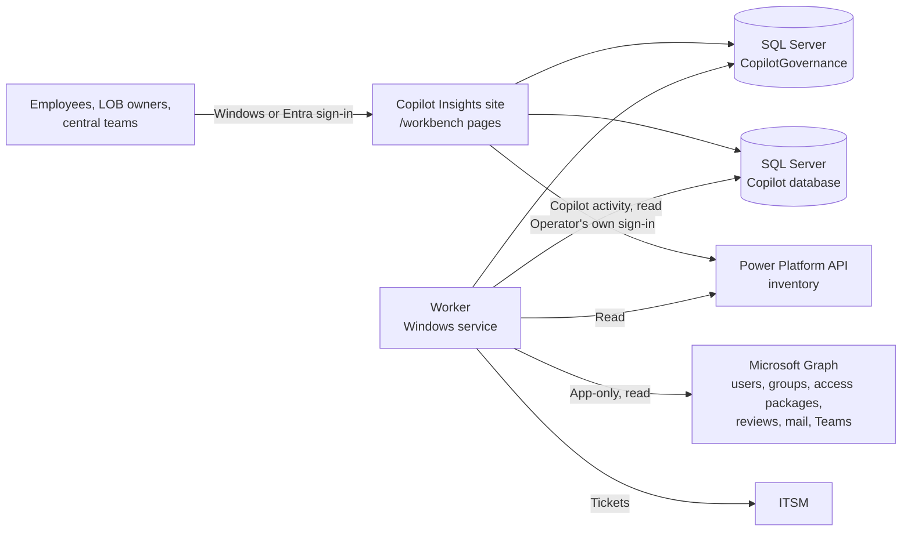

# Governance Workbench (part of Copilot Insights)

From 3.0.0 the Copilot Consumption Governance Workbench is part of Copilot Insights. Its pages are served by
the Copilot Insights dashboard under `/workbench/...`, with the dashboard's sign-in (Windows, or Entra ID) and
the dashboard's role grants. This folder holds the rest of it: its database scripts, its domain and service
code, its background worker, its test tools and its tests. It has no web site of its own any more.

The Workbench is the institution's record of who owns and funds each Copilot workload, who approved each
change under which decision right, and what evidence shows the approved setting is in place. Microsoft's admin
centers keep enforcing limits and measuring consumption; the Workbench reads from them and never writes to
them.

## Documents

They are with the rest of the product's documents, in the repository's `docs` folder:

- [OPERATIONS.md, Governance Workbench](../docs/OPERATIONS.md#governance-workbench): turning it on, who grants
  which role, every Workbench settings page, every worker job and the ledger digest.
- [DASHBOARD.md, Governance Workbench pages](../docs/DASHBOARD.md#governance-workbench-pages): every page and
  who sees it.
- [GOVERNANCE-USER-GUIDE.md](../docs/GOVERNANCE-USER-GUIDE.md): where each role starts and what it does.
- [GOVERNANCE-RUNBOOK.md](../docs/GOVERNANCE-RUNBOOK.md): what to do when something fails.
- [GOVERNANCE-TEST-ENVIRONMENT.md](../docs/GOVERNANCE-TEST-ENVIRONMENT.md): set up, run and try one request end
  to end on one PC.
- [GOVERNANCE-DECISIONS.md](../docs/GOVERNANCE-DECISIONS.md): the decisions taken, the merge's included.
- [SCHEMA.md, Governance Workbench database](../docs/SCHEMA.md#governance-workbench-database): the database.
- [DEPLOYMENT.md](../docs/DEPLOYMENT.md): installing it with the dashboard.

## What it does

- A start page per person: the journeys (routine access, new workload, exception, capacity change,
  consumption event, recertification, retirement, commercial decision, Copilot seat reservation), each showing
  who acts next.
- A register of funding owners (LOBs and Enterprise Shared), cost centers, services, control templates,
  workloads, envelopes, delegations and commercial inventory, versioned by date.
- Decisions routed by the RACI matrix: one accountable role per activity, separate records for budget,
  risk and purchase, every approval with an expiry or review date.
- Fulfillment through ITSM tickets, then verification by a second operator (read-back or attestation).
- Email and Teams notices with reminders at 50 and 80 percent of each SLA and an escalation ladder.
- Drift and unregistered-agent findings, exceptions with expiry, recertification, retirement, KPIs.
- Copilot seats: the paid Microsoft 365 Copilot license reserved per LOB, read back from the shared license
  group and each LOB's tracking group; reserved against assigned per LOB, reclaim of inactive seats (activity
  from Copilot Insights' own records), monthly chargeback certified by FinOps, and LOB seat admins who track
  their own LOB.

## What it does not do

- It never changes a Microsoft setting, buys capacity or stops consumption. Operators do that in the admin
  centers through approved ITSM tasks.
- It does not replace Entra approvals for routine access, ITSM for fulfillment, or Purview for compliance.
- A budget alert is never treated as a stop, and an allocation is never treated as a cap while tenant-pool
  draw or a PAYG plan is on. These are tested.

## How it fits together



The site and the worker share the governance database. All calls go out from the data center; nothing comes
in. The database keeps decisions, evidence and the audit trail in tamper-evident ledger tables, and shows each
LOB only its own rows. It needs SQL Server 2022 or later.

## This folder

| Folder | What is there |
|---|---|
| `src/Governance.Database` | Schema scripts (run in order, safe to rerun) and `Deploy-Database.ps1` |
| `src/Governance.Domain`, `src/Governance.Application` | Codes, rules, segregation of duties, the workflow engine |
| `src/Governance.Infrastructure`, `src/Governance.Notifications` | Microsoft, ITSM, mail and Teams adapters; message templates |
| `src/Governance.Worker` | The background jobs (a Windows service in production) |
| `tools/Governance.Seed` | The demo institution and sample requests for the test environment |
| `tools/Governance.MockItsm` | A local ITSM stand-in for testing |
| `tools/Governance.SendTestNotice` | Sends one test email and one Teams notice through the worker's adapters |
| `setup` | Test tenant setup (app registrations, groups, access packages, mailbox, Teams app) |
| `deploy` | The ledger digest script, server prerequisite checks, certificate key access and the worker's sample settings |
| `tests` | Unit, integration (real SQL Server), contract and UI tests |
| `docs/license-management` | The License Management walkthrough deck and its build scripts |

The pages themselves are in `dashboard/CopilotInsights/Pages/Workbench`, with their helpers in
`dashboard/CopilotInsights/Workbench`.

## Quick start (local test environment)

Full steps, with the grants and the settings that turn the Workbench on, are in
[GOVERNANCE-TEST-ENVIRONMENT.md](../docs/GOVERNANCE-TEST-ENVIRONMENT.md). In short, from the repository's root:

```powershell
pwsh -NoProfile -File governance\setup\Setup-TestTenant.ps1 -TenantDomain <your domain> -AdminUpn <your admin UPN> -WebBaseUrl http://localhost:5291
.\dashboard\demo\New-InsightsDemo.ps1 -SqlServer localhost -Database CopilotInsightsDemo -TrustServerCertificate -Force -Admins '<DOMAIN\you>'
pwsh -NoProfile -File governance\src\Governance.Database\Deploy-Database.ps1 -SqlServer localhost -Database CopilotGovernanceTest -CreateSqlLogins -LocalSettingsPath governance\config\appsettings.Local.json -TrustServerCertificate
dotnet run --project governance/tools/Governance.Seed -- --database CopilotGovernanceTest --sample-requests --tenant-settings governance\config\tenant.test.json
```

`-TrustServerCertificate` is for a local SQL Server with a self-signed certificate only. Then start the mock
ITSM (`dotnet run --project governance\tools\Governance.MockItsm`), the worker
(`dotnet run --project governance\src\Governance.Worker`) and the dashboard with `ConnectionStrings__Governance`
set (`dotnet run --project dashboard\CopilotInsights --launch-profile https`), and open
`http://localhost:5291/workbench/Start`.

## Tests

```powershell
dotnet test governance\tests\Governance.UnitTests\Governance.UnitTests.csproj
dotnet test governance\tests\Governance.ContractTests\Governance.ContractTests.csproj
dotnet test governance\tests\Governance.IntegrationTests\Governance.IntegrationTests.csproj
```

CI runs the unit and contract tests. The integration tests deploy a database on a local SQL Server 2022 or
later with Windows sign-in, so they run on the build machine before each release.
